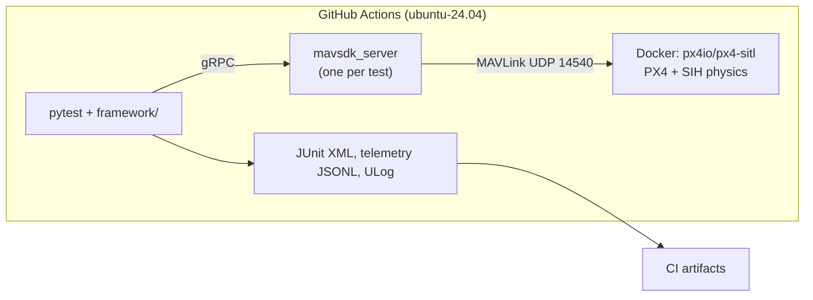

# drone-mission-sim-tests

[](https://github.com/Alexli18/drone-mission-sim-tests/actions/workflows/sim-tests.yml?query=branch%3Amain+event%3Apush)

Automated, simulation-based tests for drone missions. Each test starts a fresh
PX4 autopilot in software-in-the-loop simulation (SITL) with the SIH physics
model, headless and CPU-only on free GitHub Actions runners. Python tests
(pytest + MAVSDK) drive it over MAVLink and check the outcome; CI fails when a
scenario fails. The goal is to show simulation-based validation with mission
scenarios as data, failure injection, and CI quality gates.

**Status: milestones M1–M5 done.** This README claims only what CI shows. See the [design](docs/designs/drone_mission_sim_tests.md).

## What CI verifies today

| Check | Evidence |
|---|---|
| PX4 SITL boots headless in a pinned container and reaches "connected, GPS fix, home set" | `tests/test_smoke.py`, [run 41708569365](https://github.com/Alexli18/drone-mission-sim-tests/actions/runs/41708569365): boot to ready 2.2 s |
| Every baseline PX4 parameter is read back after boot with the value the test set | `assert_params` in the same run |
| The simulation runs at least half the requested ×10 speed | same run: effective speed factor 8.7 |
| The PX4 image comes from the Actions cache, not Docker Hub, in the test jobs | same run: `Loaded image: px4-sitl-pinned:39d5a950208a` |
| Basic flight: arm, take off to 10 m, hover 10 simulated seconds within ±1 m, land, disarm, with no mode other than Ready/Takeoff/Hold/Land | `tests/test_basic_flight.py`, green on 5 consecutive manual runs with no retries: [1](https://github.com/Alexli18/drone-mission-sim-tests/actions/runs/41710667007), [2](https://github.com/Alexli18/drone-mission-sim-tests/actions/runs/41710677497), [3](https://github.com/Alexli18/drone-mission-sim-tests/actions/runs/41710688146), [4](https://github.com/Alexli18/drone-mission-sim-tests/actions/runs/41710698804), [5](https://github.com/Alexli18/drone-mission-sim-tests/actions/runs/41710708798); max hover altitude error 0.37–0.68 m |
| Survey mission from YAML: a 60 × 40 m lawnmower pattern (14 waypoints) is generated, uploaded and flown; every waypoint is passed within 3 m and the mission duration is inside its bounds | `tests/test_survey_mission.py` (parametrized over all `mission` scenarios), [run 41713216856](https://github.com/Alexli18/drone-mission-sim-tests/actions/runs/41713216856): largest waypoint miss 1.05 m, duration 138.0 simulated s (bounds 113–242 s) |
| GPS loss 60 simulated s into a 100 × 100 m survey (MAVSDK failure injection): the vehicle leaves Mission, lands and disarms | `test_failsafe[gps_loss]`, [run 41719048626](https://github.com/Alexli18/drone-mission-sim-tests/actions/runs/41719048626): Land 5.6 s after the fault |
| Data link loss at waypoint 3 (`iptables` drops test → PX4 traffic; telemetry keeps flowing): Return, landing near home, disarm | `test_failsafe[link_loss]`, same run: Hold 95.2 s after the fault, Return 5 s later, landed 0.1 m from home |
| RC loss at waypoint 3 (the MAVLink manual-control stream stops): Return, landing near home, disarm | `test_failsafe[rc_loss]`, same run: Hold after 5.6 s, Return after 10.6 s, landed 0.7 m from home |
| Low battery (fast simulated drain): Return at the critical level, then Land at the emergency level, disarm | `test_failsafe[low_battery]`, same run: Hold 120.2 s after mission start, Return at 125.2 s, Land at 142.2 s |
| Geofence breach (offboard push north out of an inclusion fence): Return, landing near home, disarm | `test_failsafe[geofence_breach]`, same run: Hold 14.4 s after Offboard started, Return 5 s later, landed 0.4 m from home |
| Every failsafe test also fails if a failsafe fires before the fault, if the mission finishes without one, or if the wrong mode comes first (for example Land instead of Return) | pass rule in `framework/assertions.py`, covered by `tests/unit/test_assertions.py` |
| The quality gate: breaking a scenario turns the workflow red with a clear message | throwaway branch with the link loss failsafe disabled (`NAV_DLL_ACT: 0`), [run 41720870716](https://github.com/Alexli18/drone-mission-sim-tests/actions/runs/41720870716): red, `expected: the failsafe fires during the mission \| actual: mission finished first (failsafe never fired)`; the other 4 failsafe tests passed |
| A `report` job writes a results table (result, wall time, recorded metrics) to the run's job summary | `scripts/summarize.py`, [run 41720851144](https://github.com/Alexli18/drone-mission-sim-tests/actions/runs/41720851144) |
| Every simulator job stays far under the 15-minute budget per job | [run 41720851144](https://github.com/Alexli18/drone-mission-sim-tests/actions/runs/41720851144): whole workflow 2 min 56 s; longest job `failsafes` 2.2 min (5 flights), `survey` 0.8 min, `basic` 0.6 min, `unit` 0.3 min. |
| More scenarios as YAML only: a 20 × 100 m corridor survey at 8 m/s, the lawnmower survey under a 5 m/s crosswind (`SIH_WIND_E`), and RC loss under the same crosswind | [run 41819419053](https://github.com/Alexli18/drone-mission-sim-tests/actions/runs/41819419053), 3 runs each: corridor max waypoint miss 0.64–0.78 m, 86.8–88.8 simulated s (bounds 72–165); crosswind survey max miss 0.37–1.1 m, 148.6–151.4 s (about 12 s longer than without wind); RC loss under wind landed 0.1–0.9 m from home |
| Pass rate with every suite run 3 times: 11 of 11 tests passed 3/3, no retries | manual 3× run (same matrix as the nightly run), [run 41819419053](https://github.com/Alexli18/drone-mission-sim-tests/actions/runs/41819419053): 9 simulator jobs in parallel, whole workflow 3 min 3 s (an earlier 3× run with 8 tests: [run 41816091197](https://github.com/Alexli18/drone-mission-sim-tests/actions/runs/41816091197)). Three runs show the tests are not obviously flaky; they do not measure a rare failure rate |
| Config, scenario loading and validation, lawnmower geometry, coordinate conversion, failsafe pass rule, report generator | `tests/unit/` (40 tests) |

The open questions that blocked M1 were answered by spike experiments in CI
([run 41707210020](https://github.com/Alexli18/drone-mission-sim-tests/actions/runs/41707210020));
the M4 fault mechanisms by spikes S5–S9
([run 41714506246](https://github.com/Alexli18/drone-mission-sim-tests/actions/runs/41714506246),
[run 41715170080](https://github.com/Alexli18/drone-mission-sim-tests/actions/runs/41715170080)).
The results are in the design's Open Questions section.

## Architecture



## Pinned versions

| Component | Pin |
|---|---|
| PX4 SITL image | `px4io/px4-sitl:v1.18.0-rc1@sha256:39d5a950…` (release candidate; see limitations) |
| Vehicle | `sihsim_quadx` |
| MAVSDK-Python | `mavsdk-grpc==4.0.5` |
| Python | 3.11 |
| Runner | `ubuntu-24.04` |

All pins live in `config.yaml` and `pyproject.toml`.

## Running

**In CI:** every push to `main` and every pull request runs the `sim-tests`
workflow (unit job, then one simulator job per suite, then a report job). It
can also be started by hand from the Actions tab. A nightly schedule (03:17
UTC) runs every suite 3 times, and the report adds a pass rate per test. GitHub
skipped the first scheduled run, so the 3× evidence above comes from the same
matrix started by hand (`gh workflow run sim-tests.yml -f runs=3`).

**Locally (Linux, Docker, Python 3.11; `link_loss` needs `sudo iptables`):**

```sh
pip install -e ".[dev]"
docker pull "$(python -m framework.config image)"
docker tag "$(python -m framework.config image)" "$(python -m framework.config local-tag)"
pytest -m unit
pytest -m sitl
```

**Locally on macOS (Docker Desktop, Apple Silicon):** the same commands work;
the image runs natively on arm64 and its entrypoint routes MAVLink to the Mac.
SIH reaches only about half the requested speed there (×3.7 of ×10; ×8.7 on
the CI runner). The flight tests still pass; the smoke test's speed-floor check
is enforced only in CI and reported as a warning locally. Timing numbers in
this README come from CI, which is the source of truth.

## Adding a scenario

Scenarios are YAML files in `scenarios/`; tests are parametrized over them, so
a new file is a new test with no Python change. A survey mission:

```yaml
name: survey_corridor
type: mission
description: Corridor survey, 20 x 100 m, 10 m line spacing, 20 m altitude, 8 m/s.
altitude_m: 20
speed_m_s: 8
area: {origin_north_m: 10, origin_east_m: 0, width_m: 20, height_m: 100, line_spacing_m: 10}
duration_bounds_s: {min_s: 72, max_s: 165}   # simulated seconds; derive from the flight profile
```

A failsafe scenario adds the PX4 parameters it depends on, the fault, and the
expected reaction:

```yaml
type: failsafe
px4_params: {NAV_DLL_ACT: 2, COM_DL_LOSS_T: 10, COM_DLL_EXCEPT: 0}
failure:
  kind: link_loss                           # one of framework/failures.py FAULTS
  trigger: {type: at_waypoint, value: 3}    # or {type: after_s, value: <sim s>}
expected:
  mode_reached: RETURN_TO_LAUNCH            # or leave_mode: MISSION
  allowed_before: [HOLD]
  landed: true
  disarmed: true
  max_dist_from_home_m: 5
```

The loader rejects a file with unknown keys, a missing parameter the fault
needs, or an expectation that mixes `mode_reached` and `leave_mode`, and
names the problem. After boot, every parameter is read back from PX4, so a
name PX4 does not know fails the test instead of being ignored. Files starting
with `_` (such as `_baseline.yaml`, the parameters every flight shares) are
not scenarios.

## Known limitations

*   SIH physics is simplified; there are no real sensors.
*   PX4 v1.18.0-rc1 is a release candidate, chosen because it is the first
    version where SIH supports GPS failure injection. The image is pinned by
    digest.
*   The simulation runs at ×10. Timeouts in config are wall-clock seconds;
    scenario durations are measured on PX4's simulated clock.
*   Duration bounds come from a hand calculation calibrated on one measured
    flight (PX4 nearly stops at each 90° corner); they catch skipped
    waypoints or a stuck vehicle, not small timing changes.
*   PX4 v1.18.0-rc1 answers `UNSUPPORTED` to the built-in data link and RC
    failure injections (spike S5). Link loss is therefore produced with
    `iptables` (Linux only; the test is skipped on macOS), and RC loss by
    stopping the MAVLink manual-control stream.
*   PX4 rejects any mission, fence upload during a mission, or goto target
    that crosses the geofence ("Geofence violation for waypoint 3", spike
    S9). The geofence test therefore leaves the fence with offboard velocity
    setpoints, not by flying a mission.
*   Barometer and magnetometer failure injection is accepted by PX4 in SIH
    but has no visible effect (no warning, no mode change), and losing a
    motor makes the quadrotor fall with no mode change. None of these is a
    scenario; see the design's "Additions after M5".
*   After GPS loss the landing position is not checked: the reported
    position is the estimator's dead-reckoning guess, which ended 93–519 m
    from home in CI runs 41719048626 and 41819419053.
*   GitHub disables scheduled workflows after 60 days without repository
    activity (this stops the nightly runs).
