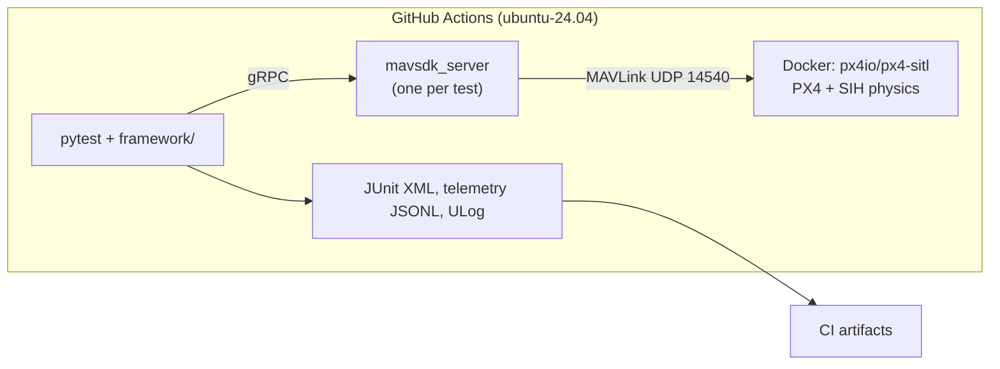
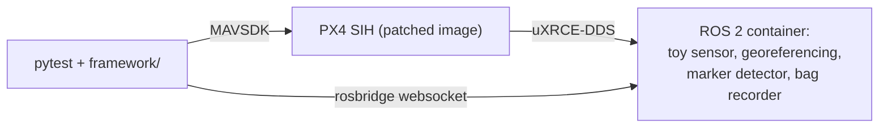

# drone-mission-sim-tests

[](https://github.com/Alexli18/drone-mission-sim-tests/actions/workflows/sim-tests.yml?query=branch%3Amain+event%3Apush)

Automated, simulation-based tests for drone missions. Each test starts a fresh
PX4 autopilot in software-in-the-loop simulation (SITL) with the SIH physics
model, headless and CPU-only on free GitHub Actions runners. Python tests
(pytest + MAVSDK) drive it over MAVLink and check the outcome; CI fails when a
scenario fails. The goal is to show simulation-based validation with mission
scenarios as data, failure injection, and CI quality gates.

**Status: milestones M1–M5 done.** This README claims only what CI shows. See the [design](docs/designs/drone_mission_sim_tests.md).

**Extension: a ROS 2 line survey.** A second suite flies a low survey line with a
toy sensor on a ROS 2 pipeline fed by PX4 over uXRCE-DDS and checks the result end to end,
plus the QA practice around it (a PX4 crash root-caused and patched, deliberate-break checks,
CI cost control). It is described in the sections [ROS 2 line survey](#ros-2-line-survey-extension)
and [Testing practice](#testing-practice); its CI evidence, including what is not stable yet, is in
[docs/evidence.md](docs/evidence.md) and [What is not stable](#what-is-not-stable).

## At a glance

*   **The risks it is built around:** a failsafe that does not fire (GPS, data link, remote control,
    battery, geofence); sensor data placed in the wrong spot (clock offset, lever arm, pose
    interpolation); sensor captures lost silently; verdicts that cannot fail (independent expected
    values, deliberate-break checks); and flakes that hide real defects. Per risk, what is tested, the
    pass rule and what is left: [docs/test-strategy.md](docs/test-strategy.md).
*   **Latest full run:** every suite three times on `main` at `abfa411`, [run 42396195239](https://github.com/Alexli18/drone-mission-sim-tests/actions/runs/42396195239):
    18 of 18 jobs green, 39 flight test results passed. The weekly line-survey plan on the same commit
    (four scenarios, three seeds): [run 42397488794](https://github.com/Alexli18/drone-mission-sim-tests/actions/runs/42397488794) passed 12 of 12, the one before it,
    [run 42396898449](https://github.com/Alexli18/drone-mission-sim-tests/actions/runs/42396898449), 11 of 12; the failure is listed below.
*   **One defect, end to end:** the vehicle sometimes hovered 0.2 m low at the start of the survey line.
    Cause: the estimator's range-finder "stuck" detector kept the range finder out of the height estimate
    for up to 12 s after take-off in the simulation. Found from 68 flight logs, confirmed with a one-line
    change in the simulation image (24 flights, fusion within 0.8 s), now watched by a rule that reads the
    PX4 log. [Case study](docs/test-strategy.md#one-defect-end-to-end-the-height-of-the-vehicle-at-the-start-of-the-line),
    [figures](docs/qa-notes.md#height-at-the-start-of-the-line).
*   **Every claim with its test, CI run, raw data and limit:** [docs/evidence.md](docs/evidence.md). The older,
    run-by-run tables are there too.

## What is not stable

Measured, not hidden.


*   **Height over the line, limit ±0.15 m.** 2 of 51 measured flights exceeded it (0.191 and 0.172 m;
    27 flights on `main` as it was and 24 on an experiment branch with a longer approach); the others
    measured 0.044 to 0.115 m. The ULog shows the drop is real (the simulator's truth was 0.2 m low
    in the worst flight). The cause is found: the range finder's stuck detector delayed the
    range-finder fusion into the height estimate by up to 12 s after take-off. With the detector
    disabled in the simulation image, the fusion started 0.70 to 0.78 s after take-off in 24 of 24
    flights (51 flights without the patch: median 1.84 s, maximum 12.2 s), and no flight went over
    0.15 m. That is too few flights to call the flake fixed, so the limit stays (the georeferencing
    node's own height band is the same 0.15 m) and the weekly run keeps counting. Details and what
    the experiment does not show: [QA notes](docs/qa-notes.md#height-at-the-start-of-the-line).
*   **Position of the second marker, limit 0.10 m.** The largest error in 48 flights recorded so far is
    0.096 m, a margin of 4 mm. The limit stays: it is what catches a georeferencing that ignores the 15 cm sensor
    offset (`docs/breaks/`).
*   **Captures wrongly marked `no_pose` after a stall of the georeferencing node (fixed).** In
    [run 42396898449](https://github.com/Alexli18/drone-mission-sim-tests/actions/runs/42396898449) the node stopped for 0.4 s twice; the captures that arrived meanwhile
    were released in one burst, and 32 of them got `no_pose` although every pose had arrived (coverage
    0.8631 against 0.95 in one test). The hold timeout now also needs wall time; a unit test models the
    stall. The stalls are rare, so CI cannot confirm the fix by itself: 4 weekly runs after it showed no
    `no_pose`. Details: [QA notes](docs/qa-notes.md#a-stall-of-the-georeferencing-node-turns-into-no_pose).
*   **A test-bench flake before take-off.** The `/rosapi/node_details` call got no reply within 30 s
    or did not exist yet: once on [run 42374481708](https://github.com/Alexli18/drone-mission-sim-tests/actions/runs/42374481708), which passed on rerun, and three times
    in two consecutive weekly runs on the fix branch ([42399318960](https://github.com/Alexli18/drone-mission-sim-tests/actions/runs/42399318960),
    [42400058966](https://github.com/Alexli18/drone-mission-sim-tests/actions/runs/42400058966)), together with one loss of 15 capture ids in the test's recordings;
    the other six weekly runs of that period were clean. It happens in the bench (rosbridge), not in the vehicle or the
    node. Not explained; see [QA notes](docs/qa-notes.md#a-stall-of-the-georeferencing-node-turns-into-no_pose).

## Architecture



## ROS 2 line survey (extension)

The same framework, extended to a drone with a payload: PX4 SIH flies a 12 m line 0.4 m above the
ground; a toy sensor in a ROS 2 Humble container takes timestamped captures over three painted
ground markers; a georeferencing node places each capture on the line from PX4's pose (received
over uXRCE-DDS), decides whether it is usable (`ok`, `outside_line`, `off_line`, `off_height`,
`no_pose`, `saturated`) and a detector finds the markers. The test talks to ROS over rosbridge
only.



What the end-to-end test checks (details in [docs/line-survey.md](docs/line-survey.md)):

*   coverage of the line by usable captures is at least 95 %, measured from the sensor's own
    positions, and the georeferencing node's own figure agrees within 1 %;
*   every painted marker is found within 10 cm, and no marker where none is painted;
*   the flight holds height (+-15 cm), cross-track (30 cm) and speed (10 %), and the PX4 log shows
    the range finder joined the height estimate within 3 s of take-off;
*   with the sensor clock 20 ms ahead or behind PX4's, every georeferenced position shifts by
    speed x offset (within 1 cm);
*   replaying the recorded bag into fresh nodes gives the same usable/unusable decisions from
    takeoff on and the same markers;
*   the sensor never falls more than 5 simulated seconds behind the poses;
*   the nodes under test subscribe to no simulation-only topic.

Also in this extension: the low-altitude PX4 parameter profile with its findings and a
true-versus-estimated cross-track check from the ULog ([QA notes](docs/qa-notes.md#low-altitude-line-following)),
the bridge setup and its gotchas ([docs/ros-bridge.md](docs/ros-bridge.md)), about 200 new unit tests
(georeferencing, the toy sensor and detector, the rosbridge client against a fake websocket
server, replay helpers, the CI planner), and four scenarios (`scenarios/line_survey_*.yaml`).

## Testing practice

[docs/test-strategy.md](docs/test-strategy.md) says per risk what is tested, what makes a test pass
or fail, where the truth comes from and what is not covered (including a risk with no test yet), and
follows one real defect from symptom to decision.

[docs/qa-notes.md](docs/qa-notes.md) is the running list of what broke and how it is guarded:

*   **A flaky crash with a root cause upstream.** PX4 v1.18.0-rc1 aborted in its lockstep scheduler
    (a glibc assertion, PX4 issue 29060). The tests now run a PX4 image rebuilt with the upstream
    fix (`docker/px4-sitl/`, `scripts/build_px4_image.sh`), cached in CI by digest and directory hash.
*   **Flakes found and root-caused:** the DDS gotchas, pose loss from a small QoS queue, CPU
    saturation of a 2-vCPU runner (a lower speed factor for the ROS suite), a sensor node falling
    behind (a lag guard), a replay race on subscriber connect, a reactor-thread bug in the rosbridge
    client and a race in the unit test's own fake server found under `pytest -n 2`. The latest:
    the late height fusion after take-off, traced to the simulated range finder tripping the
    estimator's stuck detector ([QA notes](docs/qa-notes.md#height-at-the-start-of-the-line)).
*   **Measuring the truth, not only the estimate.** `spikes/line_hold_truth.py` projects the
    simulator's ground truth from the ULog on the line and compares it with what PX4 estimates, which
    is what the test sees.
*   **Deliberate breaks.** `docs/breaks/*.patch` each break one thing the suite guards;
    `scripts/check_breaks.sh` proves the unit tests go red for every one.
*   **CI cost control.** Unit-only on push to `main`, path filters per suite, a `full-ci` label,
    docs-only changes ignored, a nightly run only if `main` changed, a weekly multi-seed pass-rate
    run, cancelled superseded pull-request runs, cached images and pip, `pytest-xdist`.

Local evidence for the extension (Apple Silicon Mac, Docker Desktop, PX4 speed factor 4, effective 1.9; **not CI
evidence**): the four `line_survey_*` scenarios passed in 3 of 3 repeats with different noise seeds, each in 23 s
(47 s with the replay check); coverage 1.0 from both nodes, markers found 3 of 3 with errors up to 7 cm and no false
marker (none on the clean line), height error 0.06 to 0.08 m, cross-track 0.17 to 0.25 m, line speed 0.97 to 0.99 m/s,
clock shift +0.0195 m and -0.0195 m for +20 and -20 ms, sensor lag at most 0.07 s. With the lever-arm break applied the
flight test fails with the markers 12 cm off (`docs/breaks/`). The earlier suites still pass locally (10 passed, the
iptables-based `link_loss` skipped as documented).

## Pinned versions

| Component | Pin |
|---|---|
| PX4 SITL image | `px4io/px4-sitl:v1.18.0-rc1@sha256:39d5a950…` (release candidate; see limitations), with its `px4` binary rebuilt from the same source plus the upstream lockstep fix (`px4-sitl-patched:39d5a950208a`) |
| ROS (extension) | `ros:humble-ros-base` by digest, Micro XRCE-DDS Agent v2.4.3 by commit, `px4_msgs` by commit, `rosbridge_server`; `roslibpy==1.7.0` in the tests |
| Vehicle | `sihsim_quadx` |
| MAVSDK-Python | `mavsdk-grpc==4.0.5` |
| Python | 3.11 |
| Runner | `ubuntu-24.04` |

All pins live in `config.yaml` and `pyproject.toml`.

## Running

**In CI:** the `sim-tests` workflow decides per event what to run (`scripts/ci_plan.sh`): a push
to `main` runs the unit job only; a pull request runs the unit job and the suites whose paths it
changes (all of them with the `full-ci` label); documentation-only changes run nothing; a nightly
schedule runs every suite only if `main` changed in the last 24 hours, and a weekly one runs the
ROS survey three times with different seeds. It can also be started by hand from the Actions tab
(`gh workflow run sim-tests.yml -f runs=3` runs every suite 3 times, as the pass-rate evidence
above did; `-f weekly=true` runs the weekly plan: the ROS survey, three seeds, all four scenarios). The report job writes the results table. See
[CI cost control](docs/qa-notes.md#ci-cost-control).

Every flight job also writes Allure results (`allure-results-<suite>-<run>` artifacts), and the `allure`
job merges them into one HTML report, the `allure-report` artifact of the run: download it, unzip it and
open `index.html`. It shows each test once per matrix cell (suite, run, seed offset, scenario and PX4
image are parameters), the line survey as steps (start, take off, mission, land and drain, final
figures, pass rules, replay), the recorded metrics, and on a failure the PX4 mode history and the last
telemetry. ULogs, rosbags and telemetry stay in the `results-*` artifacts, matched by the test id and
the run id in the test's description. See [Allure report](docs/qa-notes.md#allure-report).

**Locally (Linux, Docker, Python 3.11; `link_loss` needs `sudo iptables`):**

```sh
pip install -e ".[dev,ros]"
scripts/build_px4_image.sh        # pulls the pinned image and rebuilds px4 with the lockstep fix
pytest -m unit
pytest -m sitl tests/test_smoke.py tests/test_basic_flight.py tests/test_survey_mission.py tests/test_failsafes.py
```

The ROS line survey additionally needs the two ROS images (the base image takes a while to build once):

```sh
scripts/build_ros2_images.sh base && scripts/build_ros2_images.sh thin
pytest tests/test_line_survey.py -k line_survey_markers
```

`scripts/check_breaks.sh` applies each deliberate-break patch to a clean copy and requires the unit
tests to fail.

**Locally on macOS (Docker Desktop, Apple Silicon):** the same commands work;
the image runs natively on arm64 and its entrypoint routes MAVLink to the Mac.
SIH reaches only about half the requested speed there (×3.7 of ×10; ×8.7 on
the CI runner). The flight tests still pass; the smoke test's speed-floor check
is enforced only in CI and reported as a warning locally. The ROS suite on a Mac needs the
`--dds-own-ip` workaround (applied automatically; see [docs/ros-bridge.md](docs/ros-bridge.md)). Timing numbers in
this README come from CI, which is the source of truth.

## Adding a scenario

Scenarios are YAML files in `scenarios/`; tests are parametrized over them, so
a new file is a new test with no Python change. A survey mission:

```yaml
name: survey_corridor
type: mission
description: Corridor survey, 20 x 100 m, 10 m line spacing, 20 m altitude, 8 m/s.
altitude_m: 20
speed_m_s: 8
area: {origin_north_m: 10, origin_east_m: 0, width_m: 20, height_m: 100, line_spacing_m: 10}
duration_bounds_s: {min_s: 72, max_s: 165}   # simulated seconds; derive from the flight profile
```

A failsafe scenario adds the PX4 parameters it depends on, the fault, and the
expected reaction:

```yaml
type: failsafe
px4_params: {NAV_DLL_ACT: 2, COM_DL_LOSS_T: 10, COM_DLL_EXCEPT: 0}
failure:
  kind: link_loss                           # one of framework/failures.py FAULTS
  trigger: {type: at_waypoint, value: 3}    # or {type: after_s, value: <sim s>}
expected:
  mode_reached: RETURN_TO_LAUNCH            # or leave_mode: MISSION
  allowed_before: [HOLD]
  landed: true
  disarmed: true
  max_dist_from_home_m: 5
```

The loader rejects a file with unknown keys, a missing parameter the fault
needs, or an expectation that mixes `mode_reached` and `leave_mode`, and
names the problem. After boot, every parameter is read back from PX4, so a
name PX4 does not know fails the test instead of being ignored. Files starting
with `_` (such as `_baseline.yaml`, the parameters every flight shares) are
not scenarios.

## Known limitations

*   SIH physics is simplified; there are no real sensors.
*   PX4 v1.18.0-rc1 is a release candidate, chosen because it is the first
    version where SIH supports GPS failure injection. The image is pinned by
    digest.
*   The simulation runs at ×10. Timeouts in config are wall-clock seconds;
    scenario durations are measured on PX4's simulated clock.
*   Duration bounds come from a hand calculation calibrated on one measured
    flight (PX4 nearly stops at each 90° corner); they catch skipped
    waypoints or a stuck vehicle, not small timing changes.
*   PX4 v1.18.0-rc1 answers `UNSUPPORTED` to the built-in data link and RC
    failure injections (spike S5). Link loss is therefore produced with
    `iptables` (Linux only; the test is skipped on macOS), and RC loss by
    stopping the MAVLink manual-control stream.
*   PX4 rejects any mission, fence upload during a mission, or goto target
    that crosses the geofence ("Geofence violation for waypoint 3", spike
    S9). The geofence test therefore leaves the fence with offboard velocity
    setpoints, not by flying a mission.
*   Barometer and magnetometer failure injection is accepted by PX4 in SIH
    but has no visible effect (no warning, no mode change), and losing a
    motor makes the quadrotor fall with no mode change. None of these is a
    scenario; see the design's "Additions after M5".
*   After GPS loss the landing position is not checked: the reported
    position is the estimator's dead-reckoning guess, which ended 93–519 m
    from home in CI runs 41719048626 and 41819419053.
*   GitHub disables scheduled workflows after 60 days without repository
    activity (this stops the nightly runs).
*   The extension runs PX4 with simulation-only settings (`EKF2_IMU_CTRL 0`,
    `UXRCE_DDS_SYNCT 0`); a real vehicle needs the IMU bias states and DDS time
    synchronization. The toy sensor reads PX4's position *estimate*, so the end-to-end
    test checks the data path, not the estimator; the estimator is measured against
    ground truth by a separate spike.
*   The patched PX4 image is a stopgap until the pinned PX4 release contains the
    upstream fix; building it compiles PX4 and is slow on a cache miss.
