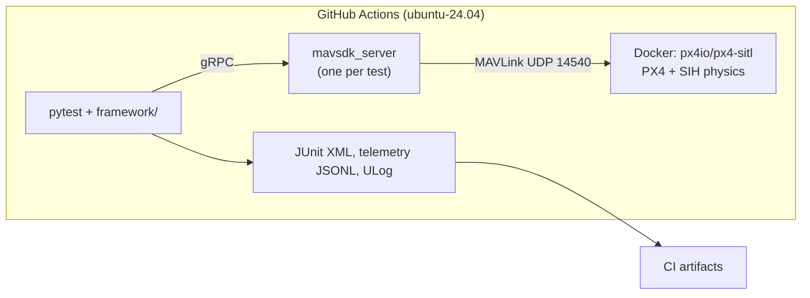
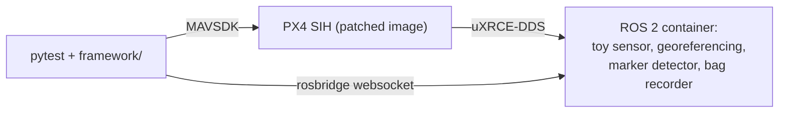

# drone-mission-sim-tests

[](https://github.com/Alexli18/drone-mission-sim-tests/actions/workflows/sim-tests.yml?query=branch%3Amain+event%3Apush)

The badge is the unit job on pushes to `main`; the flight suites run on pull requests, nightly and weekly (see [Running](#running)).

Automated, simulation-based tests for drone missions. Each test starts a fresh PX4 autopilot in
software-in-the-loop simulation (SITL) with the SIH physics model, headless and CPU-only on free GitHub
Actions runners. Python tests (pytest + MAVSDK) drive it over MAVLink and check the outcome; CI fails when a
scenario fails. Scenarios are YAML files, faults are injected (GPS, data link, remote control, battery,
geofence), and a second suite checks a ROS 2 sensor pipeline end to end. The numbers below are tied to CI
runs, except those marked as local.

**Status:** the base suite (boot, basic flight, survey missions, failsafes, CI gates: milestones M1 to M5 of the
[design](docs/designs/drone_mission_sim_tests.md)) and the ROS 2 line-survey extension are done.

## At a glance

| Suite | Checks | Tests |
|---|---|---|
| Unit | logic without a simulator: configuration, scenarios, pass rules, georeferencing, the CI planner, the rosbridge client | 272 (at the time of writing) |
| Smoke and basic flight | boot, parameters, arm, take off, hover, land | 2 |
| Survey missions | lawnmower, corridor and crosswind surveys from YAML | 3 |
| Failsafes | GPS loss, data link loss, remote control loss (also in wind), low battery, geofence breach | 6 |
| ROS 2 line survey | a toy sensor, georeferencing and marker detection on a ROS 2 pipeline; four scenarios, two on every pull request and all four weekly | 4 |

*   **Proven** (7 Nov 2026, `main` at `b5f9e42`): every suite run three times, [run 42408748342](https://github.com/Alexli18/drone-mission-sim-tests/actions/runs/42408748342):
    18 of 18 CI jobs green, 13 flight tests x 3 = 39 results passed. The weekly line-survey plan (12 tests per
    run), started by hand 15 times that day: 12 runs without a failure; the last 5, after the fixes, 60 of 60.
    The failures and what is not explained: [What is not stable](#what-is-not-stable).
*   **Not proven:** anything on hardware (there is no hardware-in-the-loop), real sensors (SIH is a
    simplified simulator and the sensors are simulated), the estimator against truth inside CI, and PX4
    beyond the pinned release candidate v1.18.0-rc1. More: [Known limitations](#known-limitations).
*   **The risks it is built around:** a failsafe that does not fire, sensor data placed in the wrong spot (clock
    offset, lever arm, interpolation), sensor captures lost silently, verdicts that cannot fail, and flakes
    that hide real defects. Per risk: [docs/test-strategy.md](docs/test-strategy.md).
*   **One defect, end to end:** the vehicle sometimes hovered 0.2 m low at the start of the survey line,
    because the estimator's range-finder "stuck" detector kept the range finder out of the height estimate
    for up to 12 s after take-off in the simulation. A one-line change in the simulation image removes the late
    fusion (24 of 24 flights, fusion within 0.8 s; too few flights to call the height flake gone) and a rule that
    reads the PX4 log watches for it.
    [Case study](docs/test-strategy.md#one-defect-end-to-end-the-height-of-the-vehicle-at-the-start-of-the-line).
*   **Read next:** [docs/test-strategy.md](docs/test-strategy.md) (what is tested and why), then
    [docs/evidence.md](docs/evidence.md) (every claim with its CI run, raw data and limit).

## Try it

```sh
pip install -e ".[dev,ros]"
scripts/build_px4_image.sh        # pulls the pinned PX4 image and rebuilds px4 with the lockstep fix
pytest -m unit                    # seconds, no simulator
pytest -m sitl tests/test_smoke.py tests/test_basic_flight.py tests/test_survey_mission.py tests/test_failsafes.py
```

Linux or macOS with Docker; `link_loss` needs `sudo iptables` and is skipped on macOS. The ROS line survey needs two
more images, see [Running](#running).

## Two flights, drawn from the CI logs


*Failsafe test `rc_loss_wind`, [run 42396195239](https://github.com/Alexli18/drone-mission-sim-tests/actions/runs/42396195239): the remote control stops at waypoint 3 in a
5 m/s wind; PX4 holds for 5 s, climbs to about 30 m, flies home and lands 0.6 m from it.*


*Line-survey test `line_survey_markers`, [run 42405381157](https://github.com/Alexli18/drone-mission-sim-tests/actions/runs/42405381157): the three painted markers are found
within 5 cm, the height stays within 9 cm of 0.40 m (limit 15 cm), and the range finder joins the height
estimate 0.75 s after lift-off (limit 3 s). Both figures are drawn by `scripts/flight_figures.py` from the
artifacts of those runs; more in [docs/evidence.md](docs/evidence.md#flight-figures).*

## Architecture



Scenarios are data: a YAML file is a test, the loader rejects unknown keys, and every PX4 parameter is read back after boot ([docs/scenarios.md](docs/scenarios.md)).

## ROS 2 line survey (extension)

The same framework is extended to a drone with a payload. PX4 SIH flies a 12 m line 0.4 m above the
ground. A toy sensor in a ROS 2 Humble container takes timestamped captures over three painted
ground markers. A georeferencing node places each capture on the line from PX4's pose (received
over uXRCE-DDS) and gives it a status that says whether the capture is usable (`ok`,
`outside_line`, `off_line`, `off_height`, `no_pose`, `saturated`). A detector finds the markers.
The test talks to ROS over rosbridge only.



The end-to-end test checks the coverage of the line, the marker positions (within 10 cm), height, cross-track
and speed, the effect of a 20 ms sensor clock offset, that replaying the recording gives the same decisions,
the sensor lag, that the nodes subscribe to no simulation-only topic and, from the PX4 log, that the range
finder joined the height estimate within 3 s of take-off. The rules, their thresholds and the reasoning:
[docs/line-survey.md](docs/line-survey.md); the bridge setup and its gotchas: [docs/ros-bridge.md](docs/ros-bridge.md); the low-altitude PX4 profile and its findings: [QA notes](docs/qa-notes.md#low-altitude-line-following).

## What is not stable

Causes, run ids and numbers: [docs/evidence.md](docs/evidence.md#what-is-not-stable).

*   **Height over the line (limit ±0.15 m):** 2 of 51 measured flights went over (0.191 and 0.172 m). Cause
    found: the simulated range finder tripped the estimator's stuck detector and stayed out of the height
    estimate for up to 12 s after take-off; the detector is disabled in the simulation image and a rule watches
    it. Too few flights since to call it fixed, so the limit stays.
    [QA notes](docs/qa-notes.md#height-at-the-start-of-the-line).
*   **Position of the second marker (limit 0.10 m):** the largest error measured was 0.096 m, a margin of 4 mm.
    The limit stays: it is what catches a georeferencing that ignores the 15 cm lever arm (`docs/breaks/`).
*   **A stall of the georeferencing node (fixed; confirmed by unit tests, not by CI):** one weekly run lost 32 captures to `no_pose` although every
    pose had arrived. The hold timeout now also needs wall time; a unit test models the stall, and the stalls are
    too rare for CI alone to confirm it.
    [QA notes](docs/qa-notes.md#a-stall-of-the-georeferencing-node-turns-into-no_pose).
*   **Test-bench failures:** `rosapi` crashed when asked about a node it did not see yet (fixed, the test waits
    for the node); one "service does not exist" and 15 capture ids that went missing from the test's recordings are not explained.
    [QA notes](docs/qa-notes.md#rosapi-dies-when-asked-about-a-node-it-does-not-see-yet).

## Testing practice

[docs/test-strategy.md](docs/test-strategy.md) says per risk what is tested, what makes a test pass or fail, where
the truth comes from and what is not covered, and follows one real defect from symptom to decision.
[docs/qa-notes.md](docs/qa-notes.md) is the running list of what broke and how it is guarded (twelve entries in
its summary table). The main ones:

*   **A crash with a root cause upstream:** PX4 v1.18.0-rc1 aborted in its lockstep scheduler (PX4 issue 29060);
    the tests run an image rebuilt with the upstream fix.
*   **Flakes found and root-caused:** DDS setup problems, pose loss from a small QoS queue, CPU saturation of a
    2-vCPU runner, a sensor node falling behind, a replay race, and the latest three: the late height fusion
    (stuck detector), a stall of the georeferencing node, and `rosapi` crashing on a node it does not see yet.
*   **Measuring the truth, not only the estimate:** `spikes/line_hold_truth.py` compares the simulator's ground
    truth from the ULog with what PX4 estimates, which is what the test sees.
*   **Deliberate breaks:** twelve patches in `docs/breaks/` each break one thing the suite guards;
    `scripts/check_breaks.sh` checks that the unit tests fail for every one; it runs in the unit job.
*   **CI cost control:** path filters per suite, a `full-ci` label, cached images, a nightly run only if `main`
    changed ([details](docs/qa-notes.md#ci-cost-control)).

## Running

**In CI:** the `sim-tests` workflow decides per event what to run (`scripts/ci_plan.sh`): a push to `main` runs the unit
job only; a pull request runs the unit job and the suites whose paths it changes (all of them with the `full-ci` label);
documentation-only changes run nothing; a nightly schedule runs every suite only if `main` changed in the last 24 hours,
and a weekly one runs the ROS survey with three seeds. By hand: `gh workflow run sim-tests.yml -f runs=3` runs every suite
three times, `-f weekly=true` runs the weekly plan. A full run of every suite three times takes about 4 minutes of wall time
([run 42408748342](https://github.com/Alexli18/drone-mission-sim-tests/actions/runs/42408748342): 4 min 10 s); a pull request that touches code takes 3.5 to 4.3 minutes. Every flight
job also writes Allure results and the `allure` job merges them into the `allure-report` artifact; ULogs, rosbags and
telemetry are in the `results-*` artifacts ([Allure report](docs/qa-notes.md#allure-report)).

**The ROS line survey locally** needs two more images (the base image takes a while to build once):

```sh
scripts/build_ros2_images.sh base && scripts/build_ros2_images.sh thin
pytest tests/test_line_survey.py -k line_survey_markers
```

**On macOS** (Docker Desktop, Apple Silicon) the same commands work; the image runs natively on arm64. SIH reaches ×3.7 of the
requested ×10 there (×8.7 on the CI runner), the flight tests still pass, and the ROS suite needs the `--dds-own-ip` workaround
(applied automatically, [docs/ros-bridge.md](docs/ros-bridge.md)). Timing numbers in this README come from CI, which is the
source of truth, except the local figures marked as such.

## Adding a scenario

Scenarios are YAML files in `scenarios/`; tests are parametrized over them, so a new file is a new test with no Python change.
A survey mission:

```yaml
name: survey_corridor
type: mission
description: Corridor survey, 20 x 100 m, 10 m line spacing, 20 m altitude, 8 m/s.
altitude_m: 20
speed_m_s: 8
area: {origin_north_m: 10, origin_east_m: 0, width_m: 20, height_m: 100, line_spacing_m: 10}
duration_bounds_s: {min_s: 72, max_s: 165}   # simulated seconds; derive from the flight profile
```

A failsafe scenario adds the PX4 parameters it depends on, the fault and the expected reaction; the loader names a wrong key or a
missing parameter. The full reference with a failsafe example: [docs/scenarios.md](docs/scenarios.md).

## Pinned versions

| Component | Pin |
|---|---|
| PX4 SITL image | `px4io/px4-sitl:v1.18.0-rc1` by digest (a release candidate), with its `px4` binary rebuilt from the same source plus two patches in `docker/px4-sitl/` |
| ROS (extension) | `ros:humble-ros-base` by digest, Micro XRCE-DDS Agent v2.4.3, `px4_msgs` by commit, `rosbridge_server`; `roslibpy==1.7.0` in the tests |
| Vehicle | `sihsim_quadx` |
| MAVSDK-Python | `mavsdk-grpc==4.0.5` |
| Python / runner | 3.11 / `ubuntu-24.04` |

All pins live in `config.yaml` and `pyproject.toml`.

## Known limitations

The main ones; the full list with the spikes and run ids behind them is in [docs/limitations.md](docs/limitations.md).

*   This is a simulation suite: nothing here is hardware-in-the-loop or a flight with a real vehicle. SIH physics is
    simplified and the sensors are simulated.
*   PX4 v1.18.0-rc1 is a release candidate, chosen because it is the first version where SIH supports GPS failure
    injection. The patched image carries two patches: the lockstep fix (a stopgap until the pinned release contains
    the upstream fix) and a simulation-only change to the range finder's stuck detector, not verified for a real range
    finder.
*   Data link loss is produced with `iptables` (Linux only) and remote control loss by stopping the MAVLink
    manual-control stream, because PX4 answers `UNSUPPORTED` to the built-in injections.
*   Some checks are coarse: after GPS loss the landing position is not checked (the descent is blind), and barometer and
    magnetometer failures have no visible effect in SIH, so they are not scenarios.
*   The line-survey test checks the data path with PX4's position estimate, not the estimator; the estimator is measured
    against ground truth by a spike outside CI.

## Terms

<details>
<summary>Terms used in this README</summary>

*   **SITL / SIH:** the PX4 autopilot software running on a computer, with a simple built-in physics model instead of a real vehicle.
*   **ULog:** PX4's flight log; the tests read it after the flight.
*   **Estimator (EKF):** the part of the autopilot that combines the sensors into the position and height it believes in. The tests compare that belief with the simulator's truth.
*   **Range finder:** the downward distance sensor that gives the height above the ground.
*   **Lever arm:** the offset of the toy sensor from the vehicle's reference point (15 cm here); a georeferencing that ignores it puts every marker 15 cm off.
*   **Georeferencing:** placing each sensor capture on the survey line from the vehicle's pose at the capture time.
*   **Fusion:** a sensor's data being used by the estimator.

</details>
