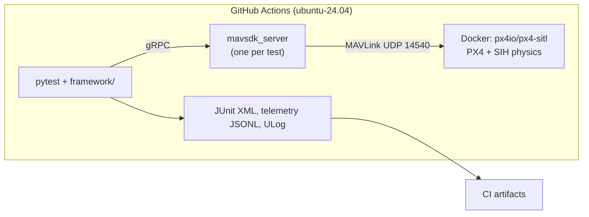

# drone-mission-sim-tests

[](https://github.com/Alexli18/drone-mission-sim-tests/actions/workflows/sim-tests.yml?query=branch%3Amain+event%3Apush)

Automated, simulation-based tests for drone missions. Each test starts a fresh
PX4 autopilot in software-in-the-loop simulation (SITL) with the SIH physics
model, headless and CPU-only on free GitHub Actions runners. Python tests
(pytest + MAVSDK) drive it over MAVLink and check the outcome; CI fails when a
scenario fails. The goal is to show simulation-based validation with mission
scenarios as data, failure injection, and CI quality gates.

**Status: milestone M3 of 5.** This README claims only what CI shows; later
milestones (failsafes, reports) are designed but not built yet. See the [design](docs/designs/drone_mission_sim_tests.md).

## What CI verifies today (M1–M3)

| Check | Evidence |
|---|---|
| PX4 SITL boots headless in a pinned container and reaches "connected, GPS fix, home set" | `tests/test_smoke.py`, [run 41708569365](https://github.com/Alexli18/drone-mission-sim-tests/actions/runs/41708569365): boot to ready 2.2 s |
| Every baseline PX4 parameter is read back after boot with the value the test set | `assert_params` in the same run |
| The simulation runs at least half the requested ×10 speed | same run: effective speed factor 8.7 |
| The PX4 image comes from the Actions cache, not Docker Hub, in the test jobs | same run: `Loaded image: px4-sitl-pinned:39d5a950208a` |
| Basic flight: arm, take off to 10 m, hover 10 simulated seconds within ±1 m, land, disarm, with no mode other than Ready/Takeoff/Hold/Land | `tests/test_basic_flight.py`, green on 5 consecutive manual runs with no retries: [1](https://github.com/Alexli18/drone-mission-sim-tests/actions/runs/41710667007), [2](https://github.com/Alexli18/drone-mission-sim-tests/actions/runs/41710677497), [3](https://github.com/Alexli18/drone-mission-sim-tests/actions/runs/41710688146), [4](https://github.com/Alexli18/drone-mission-sim-tests/actions/runs/41710698804), [5](https://github.com/Alexli18/drone-mission-sim-tests/actions/runs/41710708798); max hover altitude error 0.37–0.68 m |
| Survey mission from YAML: a 60 × 40 m lawnmower pattern (14 waypoints) is generated, uploaded and flown; every waypoint is passed within 3 m and the mission duration is inside its bounds | `tests/test_survey_mission.py` (parametrized over all `mission` scenarios), [run 41713216856](https://github.com/Alexli18/drone-mission-sim-tests/actions/runs/41713216856): largest waypoint miss 1.05 m, duration 138.0 simulated s (bounds 113–242 s) |
| Config, scenario loading, lawnmower geometry and coordinate conversion | `tests/unit/` (20 tests) |

The open questions that blocked M1 were answered by spike experiments in CI
([run 41707210020](https://github.com/Alexli18/drone-mission-sim-tests/actions/runs/41707210020));
the results are in the design's Open Questions section.

## Architecture



## Pinned versions

| Component | Pin |
|---|---|
| PX4 SITL image | `px4io/px4-sitl:v1.18.0-rc1@sha256:39d5a950…` (release candidate; see limitations) |
| Vehicle | `sihsim_quadx` |
| MAVSDK-Python | `mavsdk-grpc==4.0.5` |
| Python | 3.11 |
| Runner | `ubuntu-24.04` |

All pins live in `config.yaml` and `pyproject.toml`.

## Running

**In CI:** every push to `main` and every pull request runs the `sim-tests`
workflow (unit job, then one simulator job per suite). It can also be started
by hand from the Actions tab.

**Locally (Linux, Docker, Python 3.11):**

```sh
pip install -e ".[dev]"
docker pull "$(python -m framework.config image)"
docker tag "$(python -m framework.config image)" "$(python -m framework.config local-tag)"
pytest -m unit
pytest -m sitl
```

**Locally on macOS (Docker Desktop, Apple Silicon):** the same commands work;
the image runs natively on arm64 and its entrypoint routes MAVLink to the Mac.
SIH reaches only about half the requested speed there (×3.7 of ×10; ×8.7 on
the CI runner). The flight tests still pass; the smoke test's speed-floor check
is enforced only in CI and reported as a warning locally. Timing numbers in
this README come from CI, which is the source of truth.

## Known limitations

*   SIH physics is simplified; there are no real sensors.
*   PX4 v1.18.0-rc1 is a release candidate, chosen because it is the first
    version where SIH supports GPS failure injection. The image is pinned by
    digest.
*   The simulation runs at ×10. Timeouts in config are wall-clock seconds;
    scenario durations are measured on PX4's simulated clock.
*   Duration bounds come from a hand calculation calibrated on one measured
    flight (PX4 nearly stops at each 90° corner); they catch skipped
    waypoints or a stuck vehicle, not small timing changes.
*   GitHub disables scheduled workflows after 60 days without repository
    activity (relevant from M5, nightly runs).
