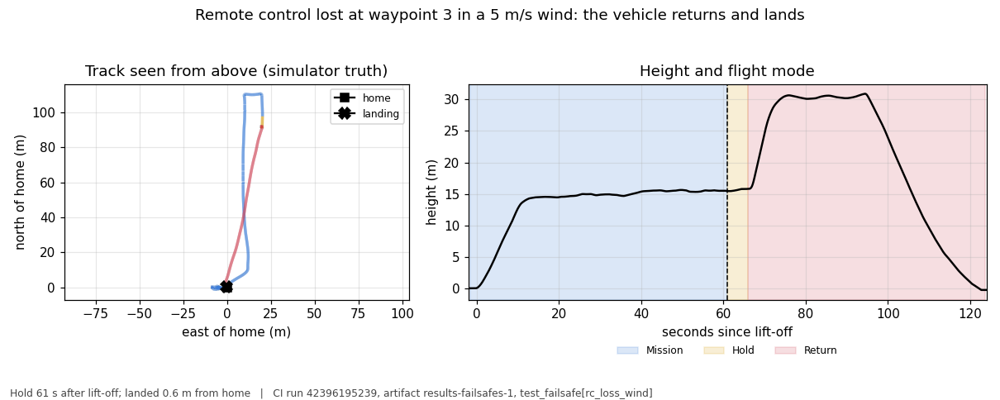
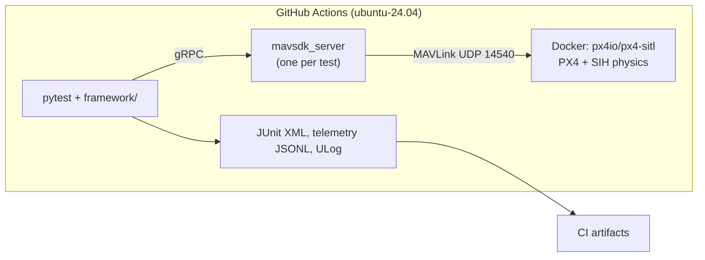
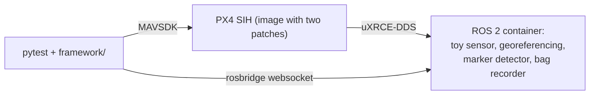
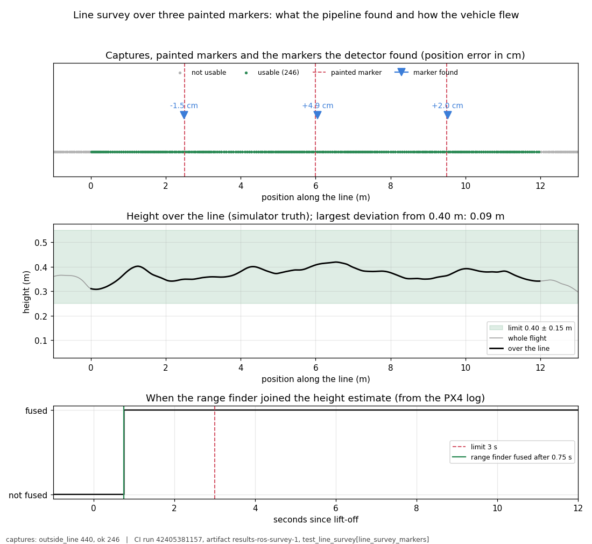

# drone-mission-sim-tests

[](https://github.com/Alexli18/drone-mission-sim-tests/actions/workflows/sim-tests.yml?query=branch%3Amain+event%3Apush)

*The badge shows the unit job on pushes to `main`. The flight suites run on pull requests, nightly and weekly ([Running](#running)).*

Automated tests for drone missions that run in simulation. Each test starts a fresh PX4 autopilot in
software-in-the-loop simulation (SITL) with PX4's built-in simplified physics (SIH), headless on free GitHub Actions
runners. Python tests (pytest and MAVSDK, PX4's Python control library) command the vehicle over MAVLink, the drone
message protocol, and check the outcome. Scenarios are YAML files, faults are injected (GPS, data link, remote
control, battery, geofence), and a second suite checks a ROS 2 sensor pipeline end to end. The aim is to show how
missions and their failures can be tested in simulation, with every claim tied to a CI run. Unfamiliar terms are
explained in [Terms](#terms).



*Failsafe test `rc_loss_wind` ([CI run 42396195239](https://github.com/Alexli18/drone-mission-sim-tests/actions/runs/42396195239)): the remote control stops at waypoint 3 in a
5 m/s wind. PX4 holds for 5 s, climbs to about 30 m, flies home and lands 0.6 m from it.*

## At a glance

| Suite | Checks | Count |
|---|---|---|
| Unit | logic without a simulator: configuration, scenarios, pass rules, georeferencing, the CI planner, the rosbridge client | 272 tests |
| Smoke and basic flight | boot, parameters, arm, take off, hover, land | 2 flight tests |
| Survey missions | lawnmower, corridor and crosswind surveys from YAML | 3 flight tests |
| Failsafes | GPS loss, data link loss, remote control loss (also in wind), low battery, geofence breach | 6 flight tests |
| ROS 2 line survey | a simulated sensor, georeferencing and marker detection on a ROS 2 pipeline, four scenarios | 4 flight tests |

Two of the four line-survey scenarios run on every pull request and all four run weekly, so a run of every suite
three times has 13 flight tests x 3 = 39 results; all 15 flight tests exist.

**Verified in CI.** On 7 Nov 2026 (`main` at `b5f9e42`) every suite ran three times in [CI run 42408748342](https://github.com/Alexli18/drone-mission-sim-tests/actions/runs/42408748342),
and all 18 CI jobs passed, including 39 of 39 flight-test results. The weekly line-survey plan (12 tests per run)
was started by hand 15 times that day: 12 runs had no failure, and the last 5 runs, made after the fixes, passed 60 of
60 tests. The 3 runs with failures are explained under [Limitations and open issues](#limitations-and-open-issues).

> [!NOTE]
> **Not verified:** anything on hardware (there is no hardware-in-the-loop), real sensors (SIH is simplified and the
> sensors are simulated), the estimator against ground truth inside CI, and PX4 versions other than the pinned release
> candidate v1.18.0-rc1.

**Read next:** [docs/test-strategy.md](docs/test-strategy.md) (what is tested and why), then
[docs/evidence.md](docs/evidence.md) (every claim with its CI run, raw data and limit). All documents are listed in
[Documentation](#documentation).

## Try it

```sh
pip install -e ".[dev,ros]"
scripts/build_px4_image.sh        # pulls the pinned PX4 image and rebuilds px4 with the lockstep fix
pytest -m unit                    # seconds, no simulator
pytest -m sitl tests/test_smoke.py tests/test_basic_flight.py tests/test_survey_mission.py tests/test_failsafes.py
```

This needs Linux or macOS with Docker. `link_loss` needs `sudo iptables` and is skipped on macOS. The ROS 2 line survey
needs two more images, see [Running](#running).

## How it works



Scenarios are data: a YAML file is a test, the loader rejects unknown keys, and every PX4 parameter is read back after
boot ([docs/scenarios.md](docs/scenarios.md)).

### ROS 2 line survey

The second suite tests a drone with a payload. PX4 SIH flies a 12 m line 0.4 m above the ground. A simulated sensor in a
ROS 2 Humble container takes timestamped captures over three painted ground markers. A georeferencing node places each
capture on the line from PX4's pose (received over uXRCE-DDS) and gives it a status (`ok`, `outside_line`, `off_line`,
`off_height`, `no_pose`, `saturated`) that says whether the capture is usable. A detector finds the markers. The test
communicates with ROS only through rosbridge.





*Line-survey test `line_survey_markers` ([CI run 42405381157](https://github.com/Alexli18/drone-mission-sim-tests/actions/runs/42405381157)): in this run the three painted markers are
found within 5 cm, the height stays within 9 cm of 0.40 m (limit 15 cm), and the range finder joins the height estimate
0.75 s after take-off (limit 3 s). Both figures are drawn by `scripts/flight_figures.py` from the artifacts of the runs
named under them ([docs/evidence.md](docs/evidence.md#flight-figures)).*

The end-to-end test checks: line coverage; marker positions (within 10 cm); height, cross-track error and speed; the
effect of a 20 ms sensor clock offset; that replaying the recording gives the same decisions; the sensor lag; and that
the nodes subscribe to no simulation-only topic. From the PX4 log it also checks that the range finder joined the height
estimate within 3 s of take-off. Rules and thresholds: [docs/line-survey.md](docs/line-survey.md). Bridge setup and its
pitfalls: [docs/ros-bridge.md](docs/ros-bridge.md). The low-altitude PX4 profile and its findings:
[QA notes](docs/qa-notes.md#low-altitude-line-following).

## Testing practice

[docs/test-strategy.md](docs/test-strategy.md) says, for each risk, what is tested, what makes a test pass or fail, where
the truth comes from and what is not covered. [docs/qa-notes.md](docs/qa-notes.md) lists what broke and how it is guarded
(twelve entries in its summary table).

*   **The tests are shown to be able to fail.** Twelve patches in `docs/breaks/` each break one behaviour that the suite
    guards, and `scripts/check_breaks.sh` verifies that the unit tests fail for every patch; it runs in the unit job. It
    found three rules of the failsafe verdict that had no test.
*   **Expected values do not come from the code under test:** [docs/oracle-independence.md](docs/oracle-independence.md)
    says, per rule, where the expected and the measured values come from.
*   **One defect, end to end:** in some flights the vehicle hovered too low at the start of the survey line, because the
    simulated range finder tripped the estimator's stuck detector. The case study follows it from symptom to decision:
    [docs/test-strategy.md](docs/test-strategy.md#one-defect-end-to-end-the-height-of-the-vehicle-at-the-start-of-the-line).
*   **Flakes with a known root cause:** a PX4 lockstep-scheduler crash (PX4 issue 29060, the tests run an image with the
    upstream fix), DDS setup problems, pose loss from a small QoS queue, CPU saturation of the 2-vCPU runner, a sensor node
    falling behind, a replay race, the late height fusion, a stall of the georeferencing node, and `rosapi` crashing on a
    node it had not seen yet.
*   **Cost of CI:** path filters per suite, a `full-ci` label, cached images, a nightly run only if `main` changed
    ([details](docs/qa-notes.md#ci-cost-control)).

## Limitations and open issues

Causes, run ids and numbers: [docs/evidence.md](docs/evidence.md#what-is-not-stable). The full list of limitations:
[docs/limitations.md](docs/limitations.md).

| Item | Status | In short |
|---|---|---|
| Height over the line (limit ±0.15 m) | cause removed in the simulation image, **not confirmed** | 2 of 51 measured flights exceeded the limit (0.191 m and 0.172 m). The simulated range finder tripped the estimator's stuck detector, which kept it out of the height estimate for up to 12 s after take-off. The detector is disabled in the image and a rule checks the delay in the PX4 log. Too few flights have run since to call it fixed. Reported to PX4 as [issue 29687](https://github.com/PX4/PX4-Autopilot/issues/29687). [QA notes](docs/qa-notes.md#height-at-the-start-of-the-line) |
| Stall of the georeferencing node | fixed, confirmed by a **unit test, not by CI** | In one weekly run, 32 captures got the status `no_pose` although every pose had arrived. The hold timeout now also requires elapsed wall time. Stalls are too rare for CI to confirm it. [QA notes](docs/qa-notes.md#a-stall-of-the-georeferencing-node-turns-into-no_pose) |
| `rosapi` crash at the start of a test | fixed | `rosapi` crashed when queried about a node it had not seen yet; the test now waits for the node. [QA notes](docs/qa-notes.md#rosapi-dies-when-asked-about-a-node-it-does-not-see-yet) |
| One "service does not exist" error; 15 capture ids missing from the test's recordings | **not explained** | Seen once each; the cause is not found. |
| Tolerance of the marker position (0.10 m) | trade-off | The largest error measured was 0.096 m, a margin of 4 mm. The tolerance is what catches a georeferencing that ignores the 15 cm lever arm (`docs/breaks/`). |

**Limitations**

*   This is a simulation suite. SIH physics is simplified and the sensors are simulated; there is no hardware-in-the-loop.
*   PX4 v1.18.0-rc1 is a release candidate, the first version where SIH supports GPS failure injection. The image carries two
    patches: the lockstep fix (a stopgap until the pinned release contains the upstream fix) and a simulation-only change to
    the range finder's stuck detector, not verified for a real range finder.
*   Data link loss is produced with `iptables` (Linux only) and remote control loss by stopping the MAVLink manual-control
    stream, because PX4 answers `UNSUPPORTED` to the built-in injections.
*   Some checks are coarse: after GPS loss the landing position is not checked, and barometer and magnetometer failures have
    no visible effect in SIH, so they are not scenarios.

## Running

| Event | What runs |
|---|---|
| Push to `main` | the unit job only |
| Pull request | the unit job and the suites whose paths it changes; every suite with the `full-ci` label |
| Documentation-only change | nothing |
| Nightly | every suite, only if `main` changed in the last 24 hours |
| Weekly (Monday) | the ROS 2 line survey with three seeds, all four scenarios |
| By hand | `gh workflow run sim-tests.yml -f runs=3` (every suite three times) or `-f weekly=true` (the weekly plan) |

`scripts/ci_plan.sh` decides this per event. A run of every suite three times takes 4 min 10 s ([CI run 42408748342](https://github.com/Alexli18/drone-mission-sim-tests/actions/runs/42408748342));
a pull request that changes code takes 3.5 to 4.3 minutes. Every flight job also writes Allure results, and the `allure`
job merges them into the `allure-report` artifact; ULogs, rosbags and telemetry are in the `results-*` artifacts
([Allure report](docs/qa-notes.md#allure-report)).

**The ROS 2 line survey locally** needs two more images (the base image is slow to build the first time):

```sh
scripts/build_ros2_images.sh base && scripts/build_ros2_images.sh thin
pytest tests/test_line_survey.py -k line_survey_markers
```

**On macOS** (Docker Desktop, Apple Silicon) the same commands work and the image runs natively on arm64. SIH reaches ×3.7
of the requested ×10 speed there (×8.7 on the CI runner), and the flight tests pass. The ROS 2 suite needs the
`--dds-own-ip` workaround, which is applied automatically ([docs/ros-bridge.md](docs/ros-bridge.md)). All other timing
numbers in this README come from CI.

## Adding a scenario

Scenarios are YAML files in `scenarios/`; tests are parametrized over them, so a new file is a new test with no Python
change. A survey mission:

```yaml
name: survey_corridor
type: mission
description: Corridor survey, 20 x 100 m, 10 m line spacing, 20 m altitude, 8 m/s.
altitude_m: 20
speed_m_s: 8
area: {origin_north_m: 10, origin_east_m: 0, width_m: 20, height_m: 100, line_spacing_m: 10}
duration_bounds_s: {min_s: 72, max_s: 165}   # simulated seconds; derive from the flight profile
```

A failsafe scenario adds the PX4 parameters it depends on, the fault and the expected reaction; the loader reports a wrong
key or a missing parameter. The full reference, with a failsafe example: [docs/scenarios.md](docs/scenarios.md).

## Documentation

| Document | What it answers |
|---|---|
| [docs/test-strategy.md](docs/test-strategy.md) | What is tested per risk, the pass rules, what is not covered; one defect end to end |
| [docs/evidence.md](docs/evidence.md) | Every claim with its test, CI run, raw data and limit; the flight figures |
| [docs/qa-notes.md](docs/qa-notes.md) | What broke, how it was found and what guards it now |
| [docs/line-survey.md](docs/line-survey.md) | The ROS 2 line-survey test: the pipeline, the rules and their thresholds |
| [docs/oracle-independence.md](docs/oracle-independence.md) | Where each expected value comes from and what it does not share with the code under test |
| [docs/ros-bridge.md](docs/ros-bridge.md) | Testing the PX4 to ROS 2 bridge and its pitfalls |
| [docs/scenarios.md](docs/scenarios.md) | The scenario file reference |
| [docs/limitations.md](docs/limitations.md) | The full list of limitations |
| [docs/designs/](docs/designs/drone_mission_sim_tests.md) | The original design (milestones M1 to M5) |

License: MIT, see [LICENSE](LICENSE).

## Pinned versions

| Component | Pin |
|---|---|
| PX4 SITL image | `px4io/px4-sitl:v1.18.0-rc1` by digest (a release candidate), with its `px4` binary rebuilt from the same source plus two patches in `docker/px4-sitl/` |
| ROS 2 (line survey) | `ros:humble-ros-base` by digest, Micro XRCE-DDS Agent v2.4.3, `px4_msgs` by commit, `rosbridge_server`; `roslibpy==1.7.0` in the tests |
| Vehicle | `sihsim_quadx` |
| MAVSDK for Python | `mavsdk-grpc==4.0.5` |
| Python / runner | 3.11 / `ubuntu-24.04` |

All pins are in `config.yaml` and `pyproject.toml`.

## Terms

<details>
<summary>Terms used in this README</summary>

*   **PX4:** an open-source autopilot for drones. **SITL:** software-in-the-loop, the autopilot software running on a computer instead of on a vehicle. **SIH:** PX4's built-in simplified physics simulation (simulation-in-hardware), which needs no graphics.
*   **MAVLink:** the standard message protocol between a drone and ground software. **MAVSDK:** a library that commands a PX4 vehicle over MAVLink; the tests use its Python version.
*   **ULog:** PX4's flight log; the tests read it after the flight.
*   **Failsafe:** a built-in reaction to a fault, such as returning home when the data link is lost.
*   **Estimator (EKF):** the part of the autopilot that combines the sensors into the position and height it uses. The tests compare that with the simulator's ground truth.
*   **Range finder:** the downward distance sensor that gives the height above the ground. **Fusion:** a sensor's data being used by the estimator. **Stuck detector:** a check that excludes a sensor whose readings do not change.
*   **Lever arm:** the offset of the payload sensor from the vehicle's reference point (15 cm here); a georeferencing that ignores it puts every marker 15 cm off.
*   **Georeferencing:** placing each sensor capture on the survey line from the vehicle's pose at the capture time.
*   **Lockstep scheduler:** the PX4 component that keeps the autopilot's clock in step with the simulation.
*   **uXRCE-DDS:** the link that carries PX4's data to ROS 2. **QoS:** ROS 2 settings for how messages are delivered (queue depth, reliability). **rosbridge:** a websocket gateway through which the tests talk to ROS 2. **Bag:** a ROS 2 recording of messages.
*   **Seed:** the number that fixes the random noise of the simulated sensor, so a run can be repeated.
*   **Experiment outside CI:** a one-off script in `spikes/` used to answer a question before a test was written.

</details>
