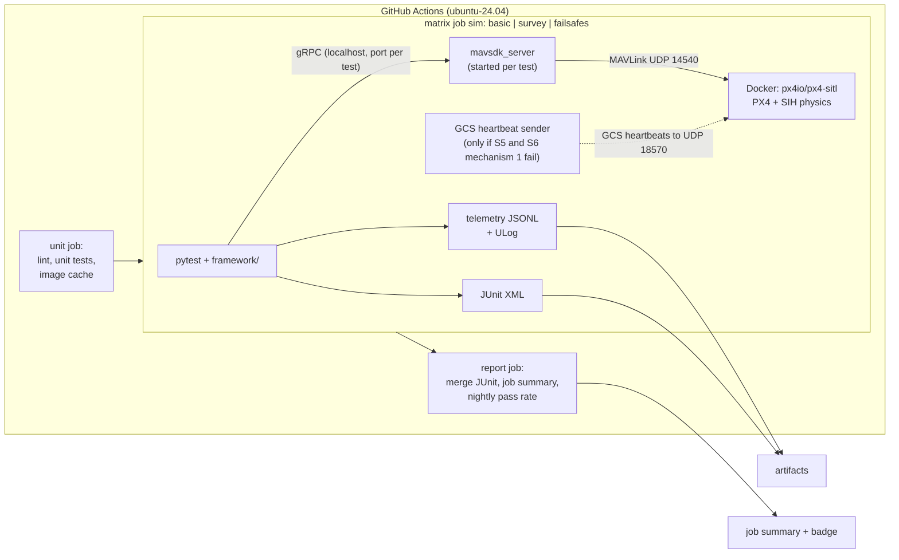

# drone-mission-sim-tests: Simulation-Based Mission Test Framework for PX4

*   **Author:** Repository owner (QA Automation Tech Lead)
*   **Status:** Reviewed (EGM review complete; ready for human review)
*   **Date:** 2026-11-03

--------------------------------------------------------------------------------

## Overview

`drone-mission-sim-tests` is a small, public test framework that flies drone
missions in the PX4 software-in-the-loop simulator (SITL) and checks the
outcome automatically. It runs on free GitHub Actions Ubuntu runners: CPU only,
no GPU, no display. The simulator is PX4 SIH (simulation-in-hardware), which
computes vehicle physics inside the PX4 process and needs no separate 3D
simulator.

Tests are written in Python with pytest and talk to PX4 over MAVLink through
MAVSDK-Python. Missions and failure scenarios are described as YAML data files,
so a new scenario is a new file, not new test code. Every push runs the suite
in CI; a failing scenario fails the workflow. Each run publishes a JUnit report,
a Markdown summary in the job page, and per-test telemetry logs.

The framework:

1.  Starts a pinned PX4 SITL build with the SIH model, headless, and waits
    until it reports ready (connected, GPS fix, home position set).
2.  Loads missions and failure scenarios from YAML and turns them into MAVSDK
    mission items and failure-injection steps.
3.  Asserts flight mode transitions, positions, landed state, and durations,
    with a deadline on every wait.
4.  Records telemetry per test and publishes reports and artifacts from CI.

Work is split into the PRD's milestones: **M1** SITL boots in CI, **M2** basic
flight, **M3** scenario-driven survey mission, **M4** failure injection and
failsafes, **M5** reports and quality gate. **M6** (ROS 2 sensor bridge) is out
of scope for this design.

The project is a portfolio piece. Its readers are hiring managers and engineers
who will open the repository, read the README, and look at the CI history. The
design therefore favors readable code and claims that CI can prove over
feature count.

### Terminology

*   **Return**: PX4's return-to-launch mode (PX4 docs: RTL; MAVSDK:
    `RETURN_TO_LAUNCH`). Hold, Land, and Mission are used the same way.
*   **Data link loss**: PX4 stops receiving heartbeats from a ground control
    station (GCS).
*   **RC loss**: PX4 stops receiving manual control input. In this project
    manual control always comes over MAVLink, never from a physical radio.
*   **Simulated time**: PX4's lockstep clock. **Wall-clock time**: real time
    on the runner.
*   **Spike**: a short CI experiment labelled S1–S9; **check**: a
    measurement labelled C1 (see Open Questions).

## The Problem

Flight software changes are risky to test on real hardware: a flight takes
people, a vehicle, a field, and good weather, and a failed failsafe test can
crash the vehicle. Simulation lets a team run the same mission hundreds of
times, inject faults on purpose (GPS loss, data link loss, RC loss, low
battery, geofence breach), and check that the autopilot reacts as configured.

The owner wants a working, inspectable demonstration of that discipline:
repeatable headless runs in CI, pass/fail gates, failure injection, and
tracking of how often each test passes, built only on free infrastructure.

## Goals

*   **G1: SITL boots in CI.** A GitHub Actions job starts a pinned PX4 SITL
    version with SIH, headless, and a smoke test confirms through MAVSDK that
    the vehicle is connected, has a GPS fix, and has a home position. The
    pinned Docker image is cached in GitHub Actions, as PRD M1 asks, so jobs
    do not depend on a Docker Hub pull on every run.
*   **G2: Basic flight passes 5 consecutive runs.** `test_basic_flight.py`
    arms, takes off to a configured altitude, hovers for a configured time,
    lands, and disarms. It asserts that the altitude stays within tolerance
    during the hover and that no failsafe happened: from the takeoff command
    until disarm, no flight mode other than Ready, Takeoff, Hold, and Land
    appears (Hold is normal here, unlike in the failsafe pass rule). Modes
    on the ground before takeoff are not checked. It passes 5 CI runs in a row with no retries.
*   **G3: Missions are data.** A lawnmower (zig-zag) survey described in
    `survey_lawnmower.yaml` (area size, line spacing, altitude, speed) is
    converted to mission items, uploaded, and flown. The test checks that
    every waypoint was reached within a configured distance, the mission
    completed, and the total duration is within configured bounds. The test
    is parametrized over every scenario file of type `mission`.
*   **G4: Failsafes are verified.** Five scenarios (GPS loss, data link loss,
    RC loss, low battery, geofence breach) each apply a fault (at a time or a
    waypoint; at boot for low battery; before the mission for geofence breach)
    and assert the expected flight mode transition and final state within a
    timeout. The PRD lists data link and RC loss as one item; this design
    tests them as two scenarios (see Alternative E). The expected behavior is
    stated in the scenario file and matches the PX4 parameters the framework
    sets.
*   **G5: CI produces evidence.** Each run publishes a JUnit XML report, a
    Markdown summary in the GitHub Actions job summary (scenario, result,
    duration, key metrics), and per-test telemetry logs and PX4 ULog files as
    artifacts. (ULog is PX4's binary flight log format.) Any failed scenario
    fails the workflow. The README shows a status badge. A nightly scheduled
    job runs the suite 3 times and reports the pass rate per scenario.
*   **G6: README claims only CI-verified results.** The README describes the
    project in one paragraph, shows an architecture diagram, explains how to
    run in CI and locally, lists every scenario with its expected behavior,
    and states known limitations. Every result it claims links to a CI run.
*   **G7: Engineering rules hold in all framework and test code.** Every
    async wait has a deadline; no bare `sleep` is used for synchronization.
    Tests do not depend on each other's state. PX4 version, tolerances, and
    timeouts live in one configuration file. Every assertion failure prints
    expected vs. actual values and the last telemetry snapshot.

## Non-Goals

*   **Physics fidelity.** SIH physics is simplified. The project does not
    validate aerodynamics, sensor noise models, or controller tuning.
*   **Gazebo or any GPU/display-based simulator.** Gazebo is used only if SIH
    cannot support a required scenario, and then only headless.
*   **Hardware-in-the-loop or real flights.** No real vehicle, flight
    controller, or radio is involved.
*   **Testing PX4 itself.** The framework checks that missions and failsafe
    configuration behave as expected. Finding PX4 bugs is not a goal.
*   **Other autopilots.** ArduPilot and other stacks are out of scope.
*   **Multi-vehicle missions.** One vehicle per test.
*   **First-class local support on macOS (Apple Silicon).** Local runs are
    best-effort and documented as such. CI on Ubuntu is the source of truth.
*   **ROS 2 / uXRCE-DDS sensor pipeline (PRD milestone M6).** Not part of this
    design. It is listed under Future Improvements and gets its own design
    once M1–M5 are stable.

## Open Questions

Each item below is either a spike (S1–S9, a short experiment run in CI before
the milestone that needs its answer) or a check (C1, a measurement). The
result is written back into this document, and only the mechanism a spike
confirms is built. Items are numbered in the order they run. If a spike and
its fallback both fail, see Risks & Mitigations. File names, config keys,
and the pass rule mentioned here are defined in the Technical Plan.

### Spikes in M1

*   **S1 — Startup log line and data directory (runs in M1; blocks M1).**
    Which line in the container log shows that PX4 finished its startup
    script? `start_sitl.sh` waits for it. The same spike confirms the PX4
    data directory path inside the image, that ULog files appear under it,
    that the image runs under `--user` (the runner's user ID) with
    `XDG_DATA_HOME` set to a fixed path, and that mounting an empty host
    directory there does not hide files the image needs. It also reads back every parameter in
    `scenarios/_baseline.yaml` and `COM_RC_OVERRIDE`, to confirm that these
    names exist in this PX4 version, and records which flight mode PX4
    reports on the ground before arming.
*   **S2 — Boot time and effective speed factor (runs in M1; blocks M1
    timeouts).** PX4 publishes no boot-to-ready figure; its own tests allow
    25 s to connect, 30 s for health, and 45 s to be armable. The spike
    measures boot-to-ready time on the GitHub runner and sets the config
    timeouts from the data. It also measures the effective speed factor
    (simulated seconds per wall-clock second) and the largest wall-clock gap
    between position messages while the recorder runs. The floor is half
    the requested factor (`min_effective_speed_ratio: 0.5`, so 5 at ×10). If
    the measured factor is below the floor, the first remedy is to set
    `speed_factor` to 3 in config (a config change; Alternative J shows ×3
    fits the budget). If ×3 cannot be held either, the next step is ×1 with
    `failsafes` split into one matrix entry per scenario (see Risks &
    Mitigations). The result and the reason are recorded. S2 also confirms
    that the recorder actually receives position at about 50 Hz wall-clock
    (the largest gap between position messages), which checks the rate
    conversion described in Technical Plan, item 5.
*   **S3 — Loss timeouts under speed-up (runs in M1; blocks M4).** When
    `PX4_SIM_SPEED_FACTOR` is set, PX4's startup script sets
    `COM_DL_LOSS_T` and `COM_RC_LOSS_T` from the speed factor, using the `bc`
    tool. The research notes read this as fixed formulas: 10 × speed factor
    for `COM_DL_LOSS_T` and 1.0 × speed factor for `COM_RC_LOSS_T`, which
    would give 100 and 10 at speed factor 10. The script runs after the
    `PX4_PARAM_*` overrides, so it may replace the scenario's values.
    *   **Method:** boot the image twice with values that differ from PX4's
        own constants and from each other (first `COM_DL_LOSS_T=7`,
        `COM_RC_LOSS_T=0.3`; then 13 and 0.7), and read both parameters
        back with MAVSDK `param.get_all_params()`, using the type PX4 reports
        (`COM_DL_LOSS_T` may be an integer parameter). Also note whether `bc`
        exists in the image; without it the script's step fails.
    *   **Possible outcomes per parameter** (the two may differ):
        *   **(a) Unchanged:** the read-back equals the configured value. PX4
            did not scale it; the framework must multiply it by the speed
            factor before boot.
        *   **(b) Scaled:** the read-back equals configured × speed factor.
            No scaling of boot parameters is needed; only the after-boot
            read-back expects configured × speed factor.
        *   **(c) Replaced:** the read-back is the same in both boots. PX4
            overwrote it; the key is removed from the scenario files.
    *   **Result:** the outcome for each parameter, and for (c) the value PX4
        uses, is written into this design. Only that case is implemented;
        there is no switch in config or code. The after-boot read-back
        checks the value PX4 holds against the recorded outcome, so a
        change in a later PX4 version is caught.
*   **S4 — Simulated clock source (runs in M1; blocks M2).** Mission
    durations are measured in simulated time, because the simulator runs
    slower than the requested speed factor when the CPU is busy. Is the
    MAVSDK `telemetry.imu()` field `timestamp_us` simulated time under
    lockstep? Fallbacks are in Risks & Mitigations.

### Check after M2

*   **C1 — CI time budget (runs after M2; blocks nothing).** Target
    wall-clock time for one full run and for the nightly 3× run: under 15
    minutes per matrix job. Confirmed from real timings after M2.

### Spikes in M4

*   **S5 — Built-in link failure injection (runs first in M4; blocks M4).**
    *   **Method:** inject `failure.inject(SYSTEM_MAVLINK_SIGNAL, OFF)` and,
        separately, `failure.inject(SYSTEM_RC_SIGNAL, OFF)` on v1.18.0-rc1
        SIH during a mission. For RC, the spike first streams manual control
        input from before arming, because PX4 ignores RC loss when there was
        no RC at arming (see "PX4 behavior this design relies on"). No
        handler for either injection was found in the v1.17 source.
    *   **Pass criterion:** the flight mode changes to the configured
        failsafe action, and the change is visible in the test's own MAVSDK
        flight mode stream (that is what the test asserts on). A command
        that returns SUCCESS without a mode change is a failure. The spike
        also reads the flight mode from the ULog file to see what PX4 did. If
        the injection also cuts the test's telemetry link, the test cannot
        see the change, and the spike counts as failed for that signal.
    *   **Result:** per signal, either the injection is the mechanism, or
        the scenario uses the fallback from S6 (data link) or S7 (RC). The
        README says which and why.
*   **S6 — Data link loss fallback (runs in M4 only if S5 fails for
    `mavlink_signal`; blocks M4).** The spike tries two mechanisms in order
    and stops at the first that produces a Return:
    1.  **Drop test → PX4 traffic:** the test stays a normal GCS (component
        ID 190) on 14540, and at the trigger `iptables` on the runner drops
        only UDP traffic from the test to PX4's port 14580. PX4 stops
        receiving the test's GCS heartbeats, while telemetry from PX4 to the
        test keeps flowing; the test sends no commands after the fault. This
        needs no second process and no extra dependency. (Host networking;
        GitHub runners have passwordless sudo; not available on macOS, which
        is best-effort anyway.)
    2.  **Companion-computer recipe**, only if mechanism 1 fails: the test
        connects as a companion computer (component ID 196), and a separate
        GCS heartbeat sender (10 Hz wall-clock, about 1 s between heartbeats
        in simulated time at ×10) is stopped at the trigger. This recipe is
        derived from the PX4 source, not documented. If it also fails, the
        spike records the MAV_TYPE and component ID of every heartbeat PX4
        received (from the ULog) to explain why, before `link_loss` is
        dropped.
*   **S7 — RC loss fallback (runs in M4 only if S5 fails for `rc_signal`;
    blocks M4).**
    Does streaming MAVSDK manual control input from before arming and then
    stopping it trigger `NAV_RCL_ACT` during a mission?
*   **S8 — Descend mode value (runs in M4; blocks M4).** Run one GPS loss and record which
    flight mode value MAVSDK reports during PX4's blind Descend (MAVSDK has
    no Descend value). The pass rule treats that value as a failsafe mode.
*   **S9 — Geofence breach mechanism (runs in M4; blocks M4).** PX4 checks missions for
    feasibility, and it may reject a mission whose waypoints lie outside an
    uploaded fence. For each mechanism below, the spike first checks that
    PX4 accepts the mission, then that the breach produces a Return. It
    tries them in order and uses the first that passes both checks:
    1.  Inclusion polygon uploaded before the mission.
    2.  Inclusion polygon uploaded after `start_mission`, checking that the
        mission keeps running.
    3.  No polygon; `GF_MAX_HOR_DIST=30` (maximum distance from home).

    Mechanism 2 uses the `after_start` hook of the fault interface (Technical
    Plan, item 7). When PX4 rejects a mission, the spike records PX4's
    message (STATUSTEXT) for the README. PX4's own tests cover geofence-aware Return, but none
    checks the breach action itself.

## Critical User Journeys

### CUJ 1: A reviewer checks that the project works

*   **Given**: A hiring manager opens the public GitHub repository.
*   **When**: They read the README and click the CI badge.
*   **Then**: They see a green workflow run, a job summary table with every
    scenario, its result, duration, and key metrics, and downloadable
    telemetry logs. Every claim in the README matches what that run shows.

### CUJ 2: The owner adds a new mission scenario

*   **Given**: The framework is green on `main`.
*   **When**: The owner adds a new YAML file of type `mission` under
    `scenarios/` and pushes.
*   **Then**: The survey test picks it up automatically (no test code
    change), flies it in CI, and reports it as a separate test case.

### CUJ 3: A failsafe regression is caught

*   **Given**: A change (for example, editing `NAV_DLL_ACT` from 2 to 3 in
    `link_loss.yaml`) makes PX4 land instead of returning on data link loss,
    while the file still expects Return.
*   **When**: CI runs the failsafe tests.
*   **Then**: The test fails with a message that states the expected mode,
    the actual mode sequence, and the last telemetry snapshot. The workflow
    is red, and the telemetry log for that test is attached as an artifact.

### CUJ 4: The owner checks for flakiness

*   **Given**: The nightly scheduled workflow has run.
*   **When**: The owner opens the run.
*   **Then**: The job summary shows each scenario's pass rate for that night
    (for example, `geofence_breach: 3/3`). Any scenario below 3/3 is
    flagged. Earlier nights are in the GitHub Actions run history.

## Technical Plan (Architecture)

### Pinned versions

| Component | Pin | Why |
|---|---|---|
| PX4 SITL | Docker image `px4io/px4-sitl:v1.18.0-rc1`, pinned by digest | Prebuilt, headless, SIH-only image (about 100 MB). v1.18 is the first PX4 version where SIH supports GPS failure injection. No build step in CI. |
| Vehicle model | `PX4_SIM_MODEL=sihsim_quadx` | The only SIH vehicle PX4 marks as stable. |
| MAVSDK | `mavsdk-grpc` (exact version pinned in `pyproject.toml`), imported as `mavsdk_grpc` | The asyncio/gRPC API used by MAVSDK-Python before 4.0; bundles `mavsdk_server` for linux x86_64. See the note below. |
| Python | 3.11 | PRD minimum; available on `ubuntu-24.04` through `actions/setup-python`. |
| Test runner | pytest, pytest-asyncio, PyYAML; pymavlink only if S5 and S6 mechanism 1 fail | pymavlink is needed only for the fallback GCS heartbeat sender. |

`mavsdk-grpc` is the original asyncio/gRPC MAVSDK-Python, republished under a
new name when the `mavsdk` package switched to a different native API in
version 4.0. This design uses `mavsdk-grpc`, not `mavsdk` 4.x (see
Alternative C).

### PX4 behavior this design relies on

These facts come from the PX4 source and docs (sources in
[the research notes](../research/px4_docs_notes.md); currently at
`research/px4_docs_notes.md`; moves to `docs/research/` in M1). The test design depends on
each of them. Other sections refer here instead of repeating them.

*   **No reboot in SITL.** PX4 SITL refuses a reboot command over MAVLink, and
    it keeps parameters, missions, and geofences in its data directory
    between runs. A clean state therefore needs a new process.
*   **Data link loss means "no GCS heartbeat".** PX4 declares data link loss
    when no MAVLink `HEARTBEAT` of type GCS has arrived for `COM_DL_LOSS_T`
    seconds. The check starts only after the first GCS heartbeat. MAVSDK
    sends GCS-type heartbeats when it runs as a ground station (component ID
    190, the default) and companion-computer heartbeats with component ID
    196. So a test connected as a ground station keeps the data link alive
    while it is connected.
*   **Arming needs a GCS when the data link failsafe is on.** With
    `NAV_DLL_ACT > 0` and no GCS heartbeat, PX4 refuses to arm ("No connection
    to the GCS"). Any GCS heartbeat source must be running before arming.
*   **RC loss needs RC at arming.** If manual control input was already
    missing when the vehicle armed, PX4 treats RC as optional and ignores its
    loss. A test for RC loss must send manual control input from before
    arming.
*   **Loss timeouts are compared in simulated time.** PX4 measures the gap
    since the last heartbeat or manual control message in simulated time,
    which runs up to `speed_factor` times faster than wall-clock time. The
    messages are sent at wall-clock rates, so at speed factor 10 a 1-second
    gap looks like 10 seconds to PX4. Loss timeouts must be scaled by the
    speed factor (who scales is decided by S3), or the senders must send
    faster.
*   **PX4 protocol timeouts are also in simulated time.** Retries of mission
    upload, geofence upload, and commands are timed in simulated time, so a
    50 ms wall-clock stall in the test process looks like 0.5 s to PX4 at
    speed factor 10.
*   **GPS loss without position aiding ends in a blind descent.** In a
    mission, PX4 falls back Return → Land → Descend (a descent without
    position control), then lands and disarms. MAVSDK has no flight mode
    value for Descend (see S8).

### Time

PX4 runs in lockstep with the simulator. At speed factor 10, one wall-clock
second is up to ten simulated seconds (S2 measures the effective factor). All
deadlines in config are in wall-clock seconds, because they guard against a
hung test. All scenario durations, duration bounds, and triggers are in
simulated seconds (clock source: S4). Loss timeouts follow the recorded S3
outcome.

### Components and data flow



1.  **SITL process.** `scripts/start_sitl.sh` starts one Docker container from
    the pinned image with `--network host`, `PX4_SIM_MODEL=sihsim_quadx`,
    `PX4_SIM_SPEED_FACTOR` from config, and one `PX4_PARAM_<NAME>=<value>`
    variable for each parameter the scenario needs. PX4 applies these at
    boot. The script also passes `PX4_HOME_LAT`, `PX4_HOME_LON`, and
    `PX4_HOME_ALT` from `px4.home` in config, so PX4 uses the configured home
    position. The container runs as the runner's user (`--user`), so its
    files can be cleaned up, with `XDG_DATA_HOME` set to a fixed path so the
    data directory does not depend on the user's home directory.

    A new, empty host directory per test is mounted as the container's
    `XDG_DATA_HOME`, so ULog files survive the container and no state leaks
    between tests. The PX4 docs give the data directory for this image as
    `$XDG_DATA_HOME/px4/rootfs/<instance>/fs/`, with ULog files under
    `log/`; S1 confirms it. The container is not started with `--rm`:
    teardown saves its log, stops it, and then removes it, so a PX4 that
    crashes at boot still leaves its log lines.

    The script waits, with a deadline, until the container log shows that PX4
    finished its startup script (the line found by S1). It then prints the
    container ID and exits 0, or exits non-zero on timeout with the last log
    lines. Vehicle readiness is checked from Python through MAVSDK, because
    readiness is defined by MAVSDK's health flags.
2.  **One fresh PX4 per test.** A pytest fixture starts a new container
    before each test and removes it after (see "No reboot in SITL"). This
    matches PX4's own SIH test runner.
3.  **MAVSDK server and readiness** (`framework/sitl.py`). For each test the
    fixture:
    1.  checks that UDP port 14540 is free, and fails with the owning
        process if not;
    2.  starts the bundled `mavsdk_server` binary as a subprocess, on a free
        gRPC port chosen for this test and `udpin://0.0.0.0:14540`;
    3.  connects with `System(mavsdk_server_address="localhost", port=<port>)`;
    4.  polls with deadlines until connected, then until
        `health.is_global_position_ok` and `is_home_position_ok`.

    Teardown terminates the server and waits for it to exit, so no server
    outlives its test. On a connection timeout, the error includes whether
    the server is still alive and its last stderr lines.

    The test itself then prepares its fault (if any) and calls
    `wait_armable` right before arming, because some fault setups (for
    example, a GCS heartbeat source) are needed before PX4 allows arming.
    PX4's own tests note that the aggregate "health all OK" flag can be set
    before the global position is valid, so they use `is_armable` as the
    final check; this design does the same. Each step has its own
    timeout from config, and a timeout fails the test with the last health
    snapshot.
4.  **Scenarios as data** (`framework/mission.py`). Each YAML file has a
    `type`: `hover`, `mission`, or `failsafe`. `mission` and `failsafe` files
    describe a survey area (origin offset from home, width, height, line
    spacing, altitude, speed). The loader generates the lawnmower waypoints
    in local metres and converts them to latitude/longitude relative to the
    home position. The test files do not hardcode coordinates. A failsafe
    scenario looks like this (full schema: implementation plan, file 13):

    ```yaml
    name: link_loss
    type: failsafe
    altitude_m: 15
    speed_m_s: 5
    area: {origin_north_m: 10, origin_east_m: 10, width_m: 100, height_m: 100, line_spacing_m: 10}
    px4_params: {SYS_FAILURE_EN: 1, NAV_DLL_ACT: 2, COM_DL_LOSS_T: 10,
                 COM_DLL_EXCEPT: 0}   # COM_FAIL_ACT_T comes from the baseline
    failure: {kind: link_loss, trigger: {type: at_waypoint, value: 3}}
    expected: {mode_reached: RETURN_TO_LAUNCH, allowed_before: [HOLD],
               landed: true, disarmed: true, max_dist_from_home_m: 5}
    ```
5.  **Telemetry recording** (`framework/telemetry_log.py`). For every test,
    background asyncio tasks subscribe to position, flight mode, landed
    state, armed state, battery, mission progress, and IMU timestamp. At ×10
    every PX4 stream arrives ten times as often per wall-clock second, so
    the recorder sets the rates it can:
    *   **Streams with a MAVSDK `set_rate_*` call** (position, battery,
        landed state, IMU): PX4 is expected to count rates in simulated time
        (not in the research notes; S2 checks it), so to get W Hz
        wall-clock the recorder requests W / speed_factor Hz. At ×10 that is
        5 Hz requested for position (50 Hz wall-clock; about 1 m between
        samples at 5 m/s) and 1 Hz for the others (10 Hz wall-clock).
    *   **Streams without a rate call** (flight mode, armed state, mission
        progress): they come from PX4's heartbeat and mission messages at
        about 1 Hz simulated, which is about 10 Hz wall-clock at ×10. A mode
        that lasts less than about 1 simulated second may not be seen. The
        pass rule only needs modes that last longer (the failsafe Hold lasts
        `COM_FAIL_ACT_T` = 5 s).

    Each update is written as one JSON line to
    `artifacts/telemetry/<test_id>.jsonl` and kept as the latest value in
    memory. The recorder reports the effective speed factor (simulated
    seconds per wall-clock second) per test in the summary. When a wait times out and the effective factor of that test is below
    the floor (S2), the timeout message says so.

    If a recorder task crashes, the test fails with its exception instead
    of reading a stale snapshot.
6.  **Assertions** (`framework/assertions.py`). Every check is a poll with a
    deadline: `wait_until(predicate, timeout, description)`. On timeout it
    raises an `AssertionError` with: what was expected, the actual value,
    the flight mode history, and the last telemetry snapshot. Direct MAVSDK
    calls (upload, arm, inject) are wrapped in `asyncio.wait_for` with
    config timeouts. No `sleep` is used for synchronization; a short poll
    interval inside `wait_until` is the only delay.
7.  **Fault application** (`framework/failures.py`). One implementation per
    fault kind; the scenario's `failure.kind` picks it. The optional trigger
    is either `{type: at_waypoint, value: N}` (wait until MAVSDK mission
    progress `current` is at least N; `current` is the item the vehicle is
    flying to) or `{type: after_s, value: T}` (T simulated seconds after the
    mission start). A fault without a trigger acts through its boot
    parameters (`low_battery`), before the mission starts, or right after it
    starts (`geofence_breach`, through the `after_start` hook, depending on
    S9).
8.  **Reports.** Each matrix job writes JUnit XML and uploads it with
    telemetry logs and ULog files. The `report` job is described in "CI
    workflow" below.

### Fault mechanisms per scenario

Every PX4 parameter the expected behavior depends on is set explicitly. Every
parameter name and value comes from YAML; the only exception is the loss
timeout scaling, if S3 gives outcome (a):

*   **`scenarios/_baseline.yaml`** holds the parameters every flight depends
    on: the failsafe delay, Return and landing behavior, Return speed,
    mission takeoff altitude, the battery floor, and
    the data link failsafe switched off (`NAV_DLL_ACT: 0`) for scenarios that
    do not test it. See the glossary below for the values.
*   **Each scenario's `px4_params`** adds its own parameters and may override
    a baseline value. The loader merges the two (scenario wins) and logs the
    merged set.

Python code adds no parameters. After the merge, the loader checks that a
fault's required parameters are present. After boot, the test reads every
configured parameter back from PX4 and compares it with the value PX4 is
expected to hold, given the recorded S3 outcome; floats are compared with a
small tolerance, because PX4 stores them as 32-bit floats. The test fails if a
value differs or PX4 does not know the name. This catches a parameter that a new PX4 version
renames, removes, or clamps. SITL defaults
differ from hardware defaults (for example, `COM_LOW_BAT_ACT` is 3 in SITL
and 0 on hardware), and they can change between PX4 versions, so they are not
relied on.

For `link_loss` and `rc_loss`, spike S5 picks one mechanism per signal. The
result is written into this table, and only that mechanism is implemented.

| Scenario | Mechanism | Parameters set | Expected behavior |
|---|---|---|---|
| `gps_loss` | MAVSDK failure injection `SENSOR_GPS`, `OFF`, 60 simulated seconds after mission start. | `SYS_FAILURE_EN=1`, `EKF2_NOAID_TOUT=5000000`, `COM_POS_FS_EPH=5` | Leaves Mission; lands and disarms. Landing position not checked (descent is blind). |
| `link_loss` | **If S5 passes:** failure injection `SYSTEM_MAVLINK_SIGNAL`, `OFF` at waypoint 3. **If S5 fails:** the S6 mechanism, first choice `iptables` dropping test → PX4 traffic at waypoint 3. | `NAV_DLL_ACT=2`, `COM_DL_LOSS_T=10`, `COM_DLL_EXCEPT=0`; `SYS_FAILURE_EN=1` if S5 passes | Return (Hold first is allowed); lands within the home tolerance; disarms. |
| `rc_loss` | Manual control input (neutral sticks: x = y = r = 0, z = 0.5) is streamed at 50 Hz wall-clock from before arming (a 0.2 s gap in simulated time at ×10, below `COM_RC_LOSS_T` = 0.5 s even before any S3 scaling). **If S5 passes:** failure injection `SYSTEM_RC_SIGNAL`, `OFF` at waypoint 3. **If S5 fails:** the stream stops at waypoint 3. | `COM_RC_IN_MODE=1`, `COM_RC_OVERRIDE=0`, `NAV_RCL_ACT=2`, `COM_RCL_EXCEPT=0`, `COM_RC_LOSS_T=0.5`; `SYS_FAILURE_EN=1` if S5 passes | Return (Hold first is allowed); lands within the home tolerance; disarms. |
| `low_battery` | SIH battery simulator drains fast (see Alternative H for why not failure injection). | `SIM_BAT_ENABLE=1`, `SIM_BAT_DRAIN≈150` (derived from mission length; implementation plan, files 29–33), `SIM_BAT_MIN_PCT=2`, `BAT_LOW_THR=0.30`, `BAT_CRIT_THR=0.20`, `BAT_EMERGEN_THR=0.05`, `COM_LOW_BAT_ACT=3` | Return at 20% (Hold first is allowed), then Land at 5% (asserted with `then_mode: LAND`); lands and disarms. Landing position not checked. |
| `geofence_breach` | Inclusion polygon (the allowed area) that contains home but not the whole survey; mechanism confirmed by S9. The survey path leaves the fence. | `GF_ACTION=3`, `GF_PREDICT=0` (or `GF_MAX_HOR_DIST=30` instead of the polygon, per S9) | Return (Hold first is allowed); lands within the home tolerance; disarms. |

PX4 compares the battery thresholds with its own estimated charge, which is
filtered and may not fall exactly linearly. The first `low_battery` run in
M4 records the actual simulated times of the critical and emergency levels,
and `SIM_BAT_DRAIN` is adjusted from them. For `low_battery`, the 15-percentage-point gap between the critical level (20%) and the
emergency level (5%) gives the vehicle time to turn back before it must land.
The battery floor (2%) is below the emergency level, so Land is expected.

#### Parameter glossary

Values without a unit are PX4 enums or flags.

| Parameter | Meaning in these scenarios |
|---|---|
| `SYS_FAILURE_EN=1` | Allows failure injection commands. |
| `NAV_DLL_ACT` | Action on data link loss: 0 = off (baseline), 2 = Return (`link_loss` only). |
| `NAV_RCL_ACT=2` | Action on RC loss: 2 = Return. |
| `COM_DL_LOSS_T`, `COM_RC_LOSS_T` | Seconds without a GCS heartbeat / manual control before loss is declared, in simulated time; see S3. |
| `COM_DLL_EXCEPT=0`, `COM_RCL_EXCEPT=0` | No mode is exempt, so the failsafe also fires in Mission mode. |
| `COM_FAIL_ACT_T=5` (baseline) | Seconds PX4 holds position before running a failsafe action. |
| `RTL_RETURN_ALT=30` (baseline) | Altitude in metres the vehicle climbs to before flying home in Return. |
| `RTL_LAND_DELAY=0` (baseline) | Seconds to hover over home before landing in Return (0 = land at once). |
| `COM_DISARM_LAND=2` (baseline) | Seconds after landing before PX4 disarms on its own. |
| `MPC_XY_CRUISE=5` (baseline) | Horizontal speed in m/s in automatic modes, including Return. |
| `MIS_TAKEOFF_ALT=15` (baseline) | Takeoff altitude in metres at the start of a mission. |
| `MIS_TKO_LAND_REQ=0` (baseline) | A mission needs no explicit takeoff or landing item; PX4 takes off implicitly. |
| `EKF2_NOAID_TOUT=5000000` | Microseconds without position aiding before the estimator reports position lost (GPS loss). |
| `COM_POS_FS_EPH=5` | Horizontal position error in metres above which PX4 treats position as lost. |
| `GF_PREDICT=0` | Geofence acts on the current position, not a predicted one. |
| `COM_RC_IN_MODE=1` | Manual control comes only over MAVLink. |
| `COM_RC_OVERRIDE=0` | Stick input never overrides an automatic mode, so the neutral stream cannot cause a mode change. |
| `SIM_BAT_ENABLE=1` | Turns on the simulated battery. |
| `SIM_BAT_DRAIN` | Seconds of simulated time to drain from 100% to 0% while armed. |
| `SIM_BAT_MIN_PCT` | Floor the simulated battery never drops below, in **percent**. The baseline sets 50, so no scenario except `low_battery` (which sets 2) can reach a low level. |
| `BAT_LOW_THR`, `BAT_CRIT_THR`, `BAT_EMERGEN_THR` | Low / critical / emergency thresholds, as a **fraction** (0.20 = 20%). At the low level PX4 only warns; it acts at critical and emergency. |
| `COM_LOW_BAT_ACT=3` | Return at the critical level, land at the emergency level. |
| `GF_ACTION=3` | Action on geofence breach: 3 = Return. |
| `GF_MAX_HOR_DIST` | Maximum horizontal distance from home in metres (0 = off); used only if S9 picks mechanism 3. |

The baseline names and meanings are taken from the PX4 parameter reference
(docs.px4.io), not from the research notes, and have not yet been checked
against v1.18.0-rc1. Spike S1 confirms that each name exists; the after-boot
read-back confirms that PX4 accepts each value.

### Pass rule for failsafe scenarios

The test observes the flight mode stream from MAVSDK telemetry. Definitions:

*   **Normal mission modes:** `READY`, `TAKEOFF`, and `MISSION`.
*   **Failsafe modes:** every other value, including `HOLD`,
    `RETURN_TO_LAUNCH`, `LAND`, and whatever MAVSDK reports during a blind
    Descend (S8).
*   **Mission start:** the first time the mode becomes `MISSION` after
    `start_mission`.
*   **Reference time:** the trigger time, or the mission start for scenarios
    without a trigger. Both its simulated and its wall-clock time are
    recorded.

In failsafe scenarios the test calls `set_return_to_launch_after_mission(False)`.
A mission that finishes without a failsafe therefore ends in Hold at the last
waypoint, never in Return. A test passes only if all of these rules hold:

1.  **The failsafe fires during the mission.** The expected mode change (rule
    3 or 4) happens before MAVSDK reports the mission finished. Otherwise the
    test fails with "failsafe never fired".
2.  **No failsafe before the fault.** Between the mission start and the
    reference time, the vehicle stays in `MISSION`. A failsafe mode in that
    window fails the test with "failsafe before fault". Modes before the
    mission start (such as Hold on the ground) are not checked.
3.  **The expected mode comes first (`mode_reached: X`).** After the
    reference time, the first mode other than `MISSION` that is not listed in
    `allowed_before` must be X. Any other mode first fails the test. If
    `then_mode: Y` is also set, Y must appear after X and before disarm;
    otherwise modes after X are not checked.
4.  **The mode is left (`leave_mode: X`).** After the reference time, the
    vehicle switches from X to any other mode. The sequence after that is not
    checked. `allowed_before` and `then_mode` must be empty with
    `leave_mode`; the loader enforces this. A GPS loss, which uses
    `leave_mode: MISSION`, therefore passes whether PX4 goes to Return,
    Land, or Descend.
5.  **The vehicle lands and disarms (`landed: true`, `disarmed: true`).** The
    vehicle reaches landed state "on ground" and is disarmed.
6.  **The vehicle lands near home (`max_dist_from_home_m: D`).** The
    horizontal distance from home at landing is at most D. `null` means the
    landing position is not checked.

All rules must hold within `timeouts_wall_s.failsafe`, counted in wall-clock
seconds from the reference time. A data link loss that leads to Land instead
of Return fails rule 3.

The PRD (M4) asks for a timeout in each scenario file, and its engineering
requirements ask for all timeouts in one place. This design keeps the one
config value (`timeouts_wall_s.failsafe`, default 180 s); the scenario sizing
below shows it is long enough.

### Scenario sizing

The failsafe scenarios are sized by hand. Each file records the calculation
in a YAML comment, the same way `survey_lawnmower.yaml` records its duration
bounds. If a scenario is too short, rule 1 fails at runtime with "failsafe
never fired"; if the timeout is too short, the wall-clock deadline fails with
the effective speed factor in its message.

*   **Survey size.** For `link_loss`, assuming S3 gives outcome (a) or (b) at
    ×10, PX4 waits 10 × 10 = 100 simulated seconds before declaring data link
    loss, plus 5 s of Hold (`COM_FAIL_ACT_T`): about 105 s. The 60 × 40 m
    mission survey (`survey_lawnmower.yaml`) leaves only about 50 simulated
    seconds after waypoint 3. The failsafe scenarios therefore use a
    100 × 100 m survey: 11 lines, about 1,200 m, about 240 simulated seconds
    at 5 m/s (about 24 wall-clock seconds at ×10). About 218 s remain after
    waypoint 3.
*   **Timeout.** Return and landing after the failsafe take about 81
    simulated seconds (156 m home at 5 m/s, a 15 m climb, a 30 m descent at
    landing speed, 2 s to disarm). Even at half the requested speed factor
    (×5), 105 + 81 simulated seconds take about 37 wall-clock seconds, well
    under the 180 s timeout.

### Configuration

One file, `config.yaml` at the repository root, holds:

*   the PX4 image reference and digest;
*   the vehicle model, the speed factor, and the effective speed floor
    ratio (`min_effective_speed_ratio`);
*   the simulated home position (`px4.home`);
*   MAVLink addresses;
*   every timeout and every tolerance.

`framework/config.py` loads it once and exposes typed values. The workflow
reads the image reference from the same file, so the version is written in
exactly one place.

### CI workflow (`.github/workflows/sim-tests.yml`)

*   **Triggers**: push, pull request, nightly schedule, and manual
    `workflow_dispatch` (no inputs). The M2 "5 green runs in a row" check is
    5 consecutive workflow runs started with `workflow_dispatch`, linked from
    the README.
*   **Runners**: `ubuntu-24.04`. The PRD names `ubuntu-latest`; this design
    pins the release deliberately, so a new Ubuntu release (Docker, glibc,
    iptables) does not change CI silently.
*   **Job `unit`**: lint and unit tests. It also primes the image cache: it
    restores the PX4 image from `actions/cache` (key: image digest), or on a
    miss pulls it by digest and saves it. The `sim` jobs start only after
    `unit`, so a cold cache causes one Docker Hub pull, not one per job. A
    lint or unit failure therefore skips the SITL jobs; this is intended, as
    there is no point flying broken framework code.
    Caching meets PRD M1 and reduces exposure to Docker Hub anonymous pull
    limits.
*   **Matrix job `sim`**: three entries, one per suite (`basic` =
    `test_smoke.py` + `test_basic_flight.py`, `survey`, `failsafes`). Each
    entry runs on its own runner: checkout → set up Python 3.11 → install →
    load the image from the cache → run pytest for that suite with JUnit
    output → upload JUnit, telemetry, and ULog artifacts (always, also on
    failure). On the nightly schedule a second matrix dimension
    `run: [1, 2, 3]` repeats each entry; on other events it is `[1]`. The
    list comes from an expression on `github.event_name`, so no extra job
    builds the matrix.
*   **Job `report`**: `needs: sim`, `if: always()`. It downloads all JUnit
    files and runs `scripts/summarize.py`, which writes the Markdown table to
    `$GITHUB_STEP_SUMMARY`, with the per-scenario pass rate on the nightly
    run. The job does not decide pass/fail: a failed `sim` entry already
    makes the workflow red.
*   **Badge**: the README badge shows the workflow status for `main` on push
    events only (`?event=push`), so a nightly result does not change it.
*   **Schedule expiry**: GitHub disables scheduled runs after 60 days of no
    repository activity. The README states this.

### Local runs on macOS (best-effort)

The image is multi-arch (amd64 and arm64), so it runs natively on Apple
Silicon with Docker Desktop. Two open points are listed in Risks &
Mitigations:

*   Docker Desktop on macOS has no Linux-style host networking for UDP.
*   A `mavsdk_server` build for macOS arm64 may be missing from the
    `mavsdk-grpc` wheel.

The README documents the local command and states that CI is the source of
truth.

## Alternatives Considered

### Alternative A: PX4 v1.17.0 (latest stable), built from source

*   **Pros**: Stable release; no release-candidate caveat in the README.
*   **Cons**:
    *   There is no prebuilt SIH image for v1.17.0, so CI must build PX4 and
        cache the build.
    *   In v1.17, SIH does not handle GPS failure injection. GPS loss would
        have to be faked by setting `SIM_GPS_USED` below 4, which is a
        simulator parameter, not failure injection.
    *   It is not verified that `px4_sitl_default` builds without Gazebo
        installed.
    *   PX4's own pytest-on-SIH CI exists only on main/v1.18, so there is no
        matching template.
*   **Reason for Rejection**: The GPS loss scenario would not demonstrate
    real failure injection, and CI would need a cached source build.

### Alternative B: PX4 v1.18.0-rc1, built from source

*   **Pros**: Same PX4 features as the chosen option. No dependency on an
    external image (published by PX4's own Docker Hub organization) staying
    available.
*   **Cons**: A full PX4 build on every cache miss, a more complex workflow
    with build caching, and the same release-candidate risk as the chosen
    option.
*   **Reason for Rejection**: Extra CI complexity for no gain in test
    coverage. Pinning the prebuilt image by digest removes content drift.
    The remaining risk, that the image is deleted, is covered in Risks &
    Mitigations; this alternative is its fallback.

### Alternative C: `mavsdk` 4.x (native binding) instead of `mavsdk-grpc`

*   **Pros**:
    *   It is the package PX4 uses in its own SIH CI, so PX4's
        `test/mavsdk_tests/conftest.py` and `autopilot_tester.py` (connect,
        health/armable waits, mission helpers) could be reused almost
        directly.
    *   It needs no separate `mavsdk_server` process.
*   **Cons**:
    *   The 4.x line started with 4.0.0 on 2026-09-22 (4.1.0 on 2026-10-27),
        so it had about six weeks of release history when this design was
        written.
    *   There are few examples outside PX4's repository.
*   **Reason for Rejection**: The owner chose the asyncio/gRPC API used by
    MAVSDK-Python before 4.0, which has more published examples. Accepted risks:
    *   `mavsdk-grpc` is now the compatibility track and may get less
        maintenance;
    *   the `mavsdk_server` process is one more part that can fail (its
        lifecycle is managed per test; see Technical Plan, item 3);
    *   PX4's test helpers cannot be reused directly.

    Switching later touches every module that calls MAVSDK: `sitl.py`,
    `telemetry_log.py`, `mission.py`, `failures.py`, `assertions.py`,
    `conftest.py`, and the three SITL test files. There is no adapter layer
    on purpose: it would be abstraction built only for a switch that may not
    happen.

### Alternative D: One SITL process for the whole run, reset between tests

*   **Pros**: Boot cost paid once; shorter runs.
*   **Cons**: State persists between tests (see "No reboot in SITL"), so a
    test can inherit state from the previous one. Clearing it by hand is
    error-prone.
*   **Reason for Rejection**: Risks test independence. The PRD allows a
    reset between tests, but PX4 SITL cannot reboot (see "No reboot in
    SITL"), so a reset would have to clear parameters, missions, and
    geofences by hand; missing one leaks state into the next test. A fresh
    container per test gives a clean state by construction.

### Alternative E: Only one of the two loss scenarios (data link or RC)

*   **Pros**: One unverified mechanism instead of two in M4.
*   **Cons**: Covers only one of the two loss failsafes the PRD names (data
    link and RC).
*   **Reason for Rejection**: The owner chose both, as two scenario files,
    for broader coverage. Accepted risk: two unverified mechanisms (S5–S7)
    and more places for flaky results.

### Alternative F: One CI job running all tests in sequence

*   **Pros**: A single job; one JUnit file; no report merge step.
*   **Cons**: Total time is the sum of all suites, and the nightly 3× run
    triples it.
*   **Reason for Rejection**: The owner chose a matrix job per suite. With
    parallel runners, wall-clock time is that of the slowest suite
    (`failsafes`) instead of the sum of all three, and each runner still hosts
    a single simulator. The cost is the report merge job.

### Alternative G: One CI job with pytest-xdist and several PX4 instances

*   **Pros**: Parallel runs inside one job; one report.
*   **Cons**: Several lockstep simulators at speed factor 10 on a 4-vCPU
    runner compete for CPU. The simulators then run slower than requested,
    and timing-sensitive failsafe tests become flaky.
*   **Reason for Rejection**: This project treats flaky results as bugs (see
    Reliability). Matrix jobs give each simulator its own runner.

### Alternative H: Battery failure injection (`SYSTEM_BATTERY`, `OFF`) for low battery

*   **Pros**: Instant and deterministic trigger.
*   **Cons**: It empties the battery at once. That tests "battery dead", not
    the low → critical → emergency sequence the scenario is named after.
*   **Reason for Rejection**: Does not test the low → critical → emergency
    sequence this scenario targets. The fast-drain battery simulator does.

### Alternative I: Gazebo instead of SIH

*   **Pros**: Richer physics and sensor models.
*   **Cons**: Needs the Gazebo packages and a separate simulator process,
    plus extra setup to run without a display.
*   **Reason for Rejection**: The PRD prefers the lightest headless
    simulator. SIH is expected to cover every scenario in this design; spikes
    S5 and S9 test this. If a scenario cannot run on SIH, it is dropped or
    Gazebo is reconsidered for that scenario only.

### Alternative J: Speed factor ×1 or ×3 instead of ×10

*   **Pros**: At ×1, simulated time equals wall-clock time. There is no
    loss-timeout scaling, no simulated/wall-clock split, and no extra load
    from faster telemetry. ×3 reduces these effects.
*   **Cons**: CI time. The estimate per failsafe test is about 300 simulated
    seconds of flight, including Return and landing; boot time (measured by
    S2) comes on top:

    | Speed factor | Flight time per failsafe test, excluding boot | Failsafe suite (5 tests), excluding boot |
    |---|---|---|
    | ×1 | about 5 minutes | about 25 minutes |
    | ×3 | about 1.7 minutes | about 8 minutes |
    | ×10 | about 0.5 minutes | about 2.5 minutes |

    At ×1 the suite exceeds the 15-minute budget (C1).
*   **Reason for Rejection**: ×10 keeps the suite inside the budget with room
    for boot time (S2) and the nightly 3× run, and matches PX4's own SIH CI.
    ×3 also fits the budget for one run and is the first fallback if S2
    shows the runner cannot hold ×10 (effective factor below half the
    requested one); the speed factor is a config value.

## Non-Functional Requirements

*   **Security**:
    *   The workflow uses no secrets.
    *   It sets `permissions: contents: read` at the top level.
    *   All actions are official GitHub actions pinned to a major version:
        `actions/checkout`, `actions/setup-python`, `actions/cache`,
        `actions/upload-artifact`, `actions/download-artifact`. Pinning by
        commit SHA would be stricter; with no secrets and read-only
        permissions, major-version pins are an accepted trade-off.
    *   The PX4 image is pinned by digest, so a changed tag cannot change
        what CI runs.
*   **Performance**:
    *   Target under 15 minutes per matrix job (C1).
    *   Each test includes one PX4 boot.
    *   If a job exceeds the target, the first lever is splitting
        `failsafes` into more matrix entries, not weakening test isolation.
*   **Reliability**:
    *   No retries and no `pytest-rerunfailures`. A flaky test is a bug to
        fix.
    *   The nightly pass rate shows how often each test passes.

## Risks & Mitigations

| Risk | Impact | Mitigation |
|---|---|---|
| S1 fails: no usable startup log line, or a different data directory | `start_sitl.sh` cannot wait for startup; ULog files are not found | The script returns once the container runs, and the MAVSDK connect deadline detects a PX4 that never comes up. ULog files are copied out with `docker cp` after the test. |
| S2: the runner cannot hold ×10 (effective factor below half the requested one) | Timing-sensitive tests become unreliable | Set `speed_factor` to 3. If ×3 cannot be held either, use ×1 and split `failsafes` into one matrix entry per scenario (about 5 minutes of flight per job, inside the budget; no loss-timeout scaling needed). Reducing PX4's own message streams is a last resort, with no build commitment, because it may need a raw MAVLink library. |
| S3 fails: read-back is impossible or the values follow none of the three outcomes | The effective loss timeout is unknown | Treat it as outcome (a) (the framework scales), keep the 50 Hz manual control stream, and double the survey margin. The README lists it as a limitation. |
| S4 fails (IMU timestamp is not simulated time) | Durations and `after_s` triggers have no clock | Use MAVLink `SYSTEM_TIME.time_boot_ms`. If that also fails, use wall-clock time × the effective speed factor measured by S2, with wider bounds, and list it as a limitation. |
| S5 and S6 both fail (data link), after the `iptables` drop and the companion-computer recipe | No working data link loss mechanism | Drop `link_loss` from the suite and list it as a README limitation. |
| S5 and S7 both fail (RC) | No working RC loss mechanism | Drop `rc_loss` and list it as a README limitation. |
| S8: MAVSDK reports Descend as a value that is also a normal mission mode | The pass rule cannot tell Descend from Mission | `gps_loss` asserts on landed and disarmed only (rules 5–6) and on the estimator reporting position lost; the README states it. |
| S9: none of the three geofence mechanisms produces a Return | Geofence scenario cannot run | Drop `geofence_breach` and list it as a README limitation. |
| v1.18.0-rc1 is a release candidate | Behavior and parameter defaults can change before v1.18.0 | The README states the exact version and digest. Behavior-relevant parameters are set explicitly and read back after boot. Moving to stable means changing two config values (tag, digest) and a full CI run. |
| The pinned image is deleted from Docker Hub | CI cannot start PX4 once the cache entry is gone (GitHub evicts entries unused for 7 days) | The digest is recorded. Switch to the next published tag, or build from source (Alternative B). |
| `mavsdk-grpc` gets less maintenance | Future PX4 versions may not be supported | Accepted risk (Alternative C); Future Improvements lists the switch. |
| A stale `mavsdk_server` or a used UDP port | Connection errors that look random | The server is started and stopped per test; the port is checked first (Technical Plan, item 3). |
| Local runs on macOS: UDP networking, `mavsdk_server` for arm64 | Local runs may not work | Best-effort only. The README states what was checked; CI is the source of truth. |
| GitHub disables schedules after 60 days without activity | Nightly evidence stops | Stated in the README. |

## Future Improvements

*   **ROS 2 sensor bridge (PRD M6)**: A ROS 2 node, connected over uXRCE-DDS,
    reads vehicle position during the survey mission and publishes a "sensor
    reading" at each survey point from a small committed gprMax GPR dataset. A
    stub detector consumes the readings, and a test checks that the buried
    target is flagged near its true position.
*   **Move to PX4 v1.18.0 stable** when it is released: change the image
    reference and digest in `config.yaml`, run the full suite, and update the
    README.
*   **Switch to the `mavsdk` 4.x native binding** if `mavsdk-grpc` stops being
    maintained (see Alternative C).
*   **Pass-rate trend across nights**: aggregate the nightly JUnit artifacts
    of the last N runs into one table. Today the per-night results are in the
    GitHub Actions run history.

## Additional Resources

*   [PRD](../prd.md): the original product requirements. Currently at
    `PRD.md`; it moves to `docs/prd.md` in M1.
*   [Research notes](../research/px4_docs_notes.md): PX4, MAVSDK, and Docker
    facts with source URLs, collected on 2026-11-03. Currently at
    `research/px4_docs_notes.md`; they move to `docs/research/` in M1.
*   [PX4 SIH docs](https://docs.px4.io/main/en/sim_sih/)
*   [PX4 failure injection docs](https://docs.px4.io/main/en/debug/failure_injection.html)
*   [PX4's own SIH test workflow](https://github.com/PX4/PX4-Autopilot/blob/main/.github/workflows/sitl_tests.yml)
    (reference design)

--------------------------------------------------------------------------------

## Detailed Implementation Plan

All paths are relative to the repository root (`drone-mission-sim-tests/`).
Work proceeds in milestone order. Each milestone ends with a green CI run on
`main` before the next one starts. Each milestone that depends on an Open
Question starts with the spike that answers it, and the answer is written
back into the design document.

### Order of work

| Milestone | Spikes first | Files created or changed |
|---|---|---|
| M1: SITL boots in CI | S1 (startup log line, data dir), S2 (boot time, effective speed factor), S3 (loss timeout values after boot), S4 (simulated clock) | Extends 2 (`pymavlink`) only if S4 needs the `SYSTEM_TIME` fallback. Creates 1–10 (file 10 with `wait_until`, `call`, and the hover/landing helpers), 12, 17 (fixtures `cfg`, `sitl`, `mavsdk_server`, `drone`, `recorder`; no scenario needed), 23 (`unit` job + `sim` job with the `basic` entry running `test_smoke.py` only), 25–27, 34, 35 (read by S1) |
| M2: Basic flight | — | Creates 11, 13 (loader for type `hover`, with baseline merge), 18, 21 (loader and merge cases); extends 17 (`scenario` fixture) and 23 (`basic` entry adds `test_basic_flight.py`) |
| M3: Survey mission | — | Creates 14, 20; extends 10 (`assert_waypoints_reached`, `assert_duration`), 13 (type `mission`, lawnmower, mission plan), 21 (geometry cases), 23 (`survey` entry) |
| M4: Failsafes | S5 (built-in link injection), then S6/S7 only for signals where S5 failed, S8 (Descend value), S9 (geofence mechanism) | Creates 15, 22, 29–33, 36; extends 10 (`assert_failsafe_outcome`, using the S8 value), 13 (type `failsafe`, `required_params` check), 21 (failsafe schema cases), 23 (`failsafes` entry). Only if S5 and S6 mechanism 1 fail: creates 16, extends 2 (`pymavlink`), 8 and 17 (`compid` parameter for component ID 196), 13 (`Failure.compid` field) |
| M5: Reports and gate | C1 (time budget, measured) | Creates 24; extends 23 (`schedule` trigger, nightly `run` dimension, `report` job) and 1 (final README) |

Each file has one milestone that creates it, and every later extension is
listed in this table. File 28 (this design) exists from the start, and every
milestone writes its spike results into it. M1 is green with the smoke test
and the config unit test (file 34), so `pytest -m unit` never runs with zero
tests.

### Shared conventions

*   **Test ID.** `test_id` is `request.node.name` with every character outside
    `[A-Za-z0-9_.-]` replaced by `_` (for example
    `test_failsafes_link_loss_`). It names the container
    (`sim-<test_id>`), the telemetry file, the ULog directory, and the
    container log file. Pytest node IDs contain `:` and `[`, which break
    Docker bind mounts and artifact upload.
*   **Paths passed to Docker** are absolute (`realpath`) and use
    `--mount type=bind,source=…,target=…`.
*   **Timeouts** are named config keys under `timeouts_wall_s`; every wait in
    this plan names the key it uses.
*   **Scenario-less tests** (the smoke test) boot with the baseline parameters
    only (file 35), and the read-back checks the baseline.
*   **Mechanism names** are always qualified with their spike: "S6
    mechanism 1", "S9 mechanism 2".

### Target Files to Create/Modify

Files are numbered 1–36. Number 19 is unused (an earlier entry was merged
into file 23); the other numbers are kept so cross-references stay stable.

#### 1. `README.md` (Create)

*   **Type / Scope**: Project documentation.
*   **Proposed Changes**: Sections in this order:
    *   a one-paragraph summary (what the project shows: simulation-based
        validation of drone missions, failure injection, CI gates);
    *   the CI badge for `main` on push events (`?event=push`);
    *   a Mermaid architecture diagram (GitHub Actions → PX4 SITL (SIH) ↔
        MAVSDK ↔ pytest → reports/artifacts);
    *   a pinned versions table (PX4 version and image digest, `mavsdk-grpc`
        version);
    *   how to run in CI (push, manual dispatch) and locally (Linux command;
        macOS best-effort with the known networking limit);
    *   a scenario table (scenario, fault mechanism, parameters, expected
        behavior), written by hand from the scenario files;
    *   known limitations: SIH physics is simplified; no real sensors;
        release-candidate PX4; how data link loss and RC loss are produced,
        per the S5/S6 results; timing at speed factor 10; the `iptables`
        mechanism is Linux-only, if S6 uses it; GitHub stops scheduled runs
        after 60 days without repository activity; any scenario dropped per
        Risks & Mitigations.

    Written at M1 with only what M1 proves, then extended at each milestone.
    Every result claim links to a CI run.

#### 2. `pyproject.toml` (Create)

*   **Type / Scope**: Python package and tool configuration.
*   **Proposed Changes**:
    *   Build backend `hatchling`; package `framework`; Python ≥ 3.11.
    *   Runtime dependencies pinned to exact versions: `mavsdk-grpc==4.0.5`,
        `pytest`, `pytest-asyncio`, `PyYAML` (exact versions resolved at M1).
        `pymavlink` is added at M4 only if S5 and S6 mechanism 1 fail (S6
        mechanism 2), or if S4 falls back to `SYSTEM_TIME`.
    *   Optional dependency group `dev = ["ruff"]`, so `pip install -e .[dev]`
        works.
    *   Pytest config: `testpaths = ["tests"]`, `asyncio_mode = "auto"`,
        markers `sitl` (needs a running simulator), `unit` (no simulator) and
        `scenario(file)` registered, `junit_family = "xunit1"` (supports
        `record_property`), `junit_logging = "system-out"`.
    *   Ruff: default rules plus import sorting, line length 100.

#### 3. `config.yaml` (Create)

*   **Type / Scope**: Single source of configuration.
*   **Proposed Changes**: Schema:

    ```yaml
    px4:
      image: px4io/px4-sitl:v1.18.0-rc1
      digest: sha256:<resolved at M1>
      model: sihsim_quadx
      speed_factor: 10
      home: {lat: 47.397742, lon: 8.545594, alt: 488.0}   # passed to PX4 as PX4_HOME_*; same as PX4's default SITL home
    mavlink:
      api_url: udpin://0.0.0.0:14540
    telemetry_wall_hz:             # target wall-clock rates
      position: 50
      other: 10
    timeouts_wall_s:               # guards against hangs
      container_start: 60
      connect: 30
      mavsdk_call: 30              # asyncio.wait_for on direct MAVSDK calls
      health: 60
      armable: 60
      takeoff: 60
      hover: 60                    # basic flight hover phase
      mission_start: 30            # until the first MISSION after start_mission
      land: 120
      mission: 300
      failsafe: 180
    tolerances:
      altitude_m: 1.0
      waypoint_m: 3.0
      home_m: 5.0
    poll_interval_s: 0.1
    min_effective_speed_ratio: 0.5 # floor = ratio × speed_factor; S2 threshold
    ```

    Timeout values above are starting values. S2 replaces each with the
    measured p95 × 1.5, rounded up to whole seconds. The S3 outcome is not a
    config value; it is recorded in this design and implemented directly
    (file 8).

#### 4. `framework/__init__.py` (Create)

*   **Type / Scope**: Package marker.
*   **Proposed Changes**: Empty, apart from a module docstring naming the
    package's purpose.

#### 5. `framework/config.py` (Create)

*   **Type / Scope**: Config loader.
*   **Proposed Changes**:
    *   Frozen dataclasses `Px4Config`, `MavlinkConfig`, `TelemetryRates`,
        `Timeouts`, `Tolerances`, and `Config` (which also holds
        `poll_interval_s` and `min_effective_speed_ratio`).
    *   `load_config(path: Path = <repo>/config.yaml) -> Config` validates
        that every key is present and fails with the key name if not.
    *   CLI entries, so shell steps read the pin from this file:
        *   `python -m framework.config image` prints `image@digest`;
        *   `python -m framework.config digest` prints the digest (cache key);
        *   `python -m framework.config local-tag` prints
            `px4-sitl-pinned:<first 12 hex chars of the digest>`.

#### 6. `scripts/start_sitl.sh` (Create)

*   **Type / Scope**: Bash script, used by the pytest fixture and by hand.
    `set -euo pipefail`.
*   **Proposed Changes**:
    *   Usage: `start_sitl.sh --image <local-tag> --name <name> --log-dir
        <dir> --model <model> --speed-factor <n> --home-lat <x> --home-lon
        <y> --home-alt <z> --timeout <s> [--param NAME=VALUE ...]`.
    *   `--log-dir` must be an existing, empty directory (created by
        `SitlInstance`); the script resolves it with `realpath` and fails
        otherwise.
    *   Runs `docker run -d --pull never --network host --name <name>
        --user "$(id -u):$(id -g)" -e XDG_DATA_HOME=/px4data -e
        PX4_SIM_MODEL=<model> -e PX4_SIM_SPEED_FACTOR=<n> -e PX4_HOME_LAT=…
        -e PX4_HOME_LON=… -e PX4_HOME_ALT=… -e PX4_PARAM_<NAME>=<VALUE> …
        --mount type=bind,source=<log-dir>,target=/px4data <local-tag>`. The
        whole `XDG_DATA_HOME` is mounted, so every folder PX4 creates under it
        belongs to the runner's user (Docker would create parent folders of a
        deeper target as root). ULog files end up in
        `<log-dir>/px4/rootfs/0/fs/log/`. `--pull never` makes a missing local image fail loudly
        instead of pulling.
    *   Polls `docker logs <name> 2>&1 | grep -F "<S1 line>" >/dev/null` in a
        bash loop on elapsed seconds (0.5 s poll interval, the only delay)
        until the line appears or `--timeout` passes. On timeout it prints the
        last 50 log lines and exits 1.

#### 7. `scripts/stop_sitl.sh` (Create)

*   **Type / Scope**: Bash script.
*   **Proposed Changes**: `stop_sitl.sh --name <name> --log-file <path>`:
    saves `docker logs <name>` (stdout and stderr) to `<path>`, then
    `docker stop -t 10` (PX4 gets 10 s to close its ULog file), then
    `docker rm -f`. Exits 0 if the container is already gone. The container
    is started without `--rm`, so a PX4 that crashed at boot still has its
    log when teardown runs. Used by the fixture teardown and for manual
    cleanup.

#### 8. `framework/sitl.py` (Create)

*   **Type / Scope**: SITL lifecycle, MAVSDK server, connection, readiness,
    parameter checks.
*   **Proposed Changes**:
    *   `class SitlInstance(cfg, test_id, params)`:
        *   `start()` creates `artifacts/ulog/<test_id>/` (it must not exist
            yet), then calls `start_sitl.sh` with `--image` = `local-tag`,
            `--model`, `--speed-factor` and `--home-*` from `cfg.px4`,
            `--log-dir artifacts/ulog/<test_id>`, `--timeout` =
            `timeouts_wall_s.container_start`, and one `--param` per boot
            parameter.
        *   `stop()` calls `stop_sitl.sh --log-file
            artifacts/logs/<test_id>.log`; never raises in teardown, logs
            instead.
    *   `class MavsdkServer`:
        *   `start(cfg)` checks that the UDP port from `mavlink.api_url` is
            free (fails with "port in use"; names the owning process if
            `ss -ulpn` shows it). It lets the OS pick a free TCP port (bind to
            port 0, close, reuse; the short race is accepted on a
            single-test runner). It then starts
            `Path(mavsdk_grpc.__file__).parent / "bin" / "mavsdk_server"` with
            `-p <grpc_port> --sysid 245 --compid 190 <api_url>` as a
            subprocess.
        *   `stop()` terminates it and waits for exit.
        *   `status()` returns alive/exit code and the last stderr lines, for
            connection error messages.
    *   `async def connect(cfg, server) -> System`: creates
        `System(mavsdk_server_address="localhost", port=server.port)`,
        awaits `connect()`, then iterates `core.connection_state()` with
        `async for` inside `asyncio.wait_for(timeouts_wall_s.connect)` until
        connected. On timeout the error includes `server.status()`.
    *   `async def wait_ready(drone, cfg)`: iterates `telemetry.health()`
        inside `asyncio.wait_for(timeouts_wall_s.health)` until
        `is_global_position_ok` and `is_home_position_ok`, keeping the last
        value. On timeout the error includes that last `health()` value.
        Called by the `drone` fixture.
    *   `async def wait_armable(drone, cfg)`: same pattern with
        `timeouts_wall_s.armable`, until `is_armable`. Called by each test
        after any fault `prepare` and before arming.
    *   `async def assert_params(drone, boot_params: dict)`:
        *   `boot_params` is exactly the set passed to `SitlInstance`, after
            any S3 scaling.
        *   It calls `param.get_all_params()` once, wrapped in `call(...)`
            with `timeouts_wall_s.mavsdk_call`, and looks each name up in
            `int_params` or `float_params`, so PX4 decides the type (YAML
            writes `5` for FLOAT parameters such as `COM_FAIL_ACT_T`).
        *   Expected value: the boot value. Under S3 outcome (b) a loss
            timeout is expected at boot value × speed factor; under outcome
            (c), at the value recorded in this design.
        *   INT32 values are compared exactly, FLOAT values with
            `math.isclose(rel_tol=1e-6)`. A name in neither list is reported
            as "unknown to PX4".
        *   Fails with a table of name, expected, and actual if any differ.
            Called by the `drone` fixture.
    *   `def scaled_loss_params(params: dict, cfg) -> dict`: written only if
        S3 gives outcome (a) for a parameter; it multiplies that parameter by
        the speed factor before boot. No boot-parameter scaling is needed for
        outcomes (b) and (c); their only code is the expected-value rule in
        `assert_params`.

#### 9. `framework/telemetry_log.py` (Create)

*   **Type / Scope**: Telemetry recording and simulated clock.
*   **Proposed Changes**:
    *   `class TelemetryRecorder(drone, cfg, test_id)`:
        *   `async start()` first sets the rates of the streams that have a
            MAVSDK rate call (position, battery, landed state, in_air, IMU)
            to `telemetry_wall_hz / speed_factor`. PX4 is expected to
            count rates in simulated time; if S2 shows rates are in wall-clock
            time, the division is dropped. Flight mode, armed state, mission
            progress, and health have no rate call.
        *   It then launches one asyncio task per stream (position,
            flight_mode, landed_state, armed, in_air, battery,
            mission_progress, health, IMU timestamp). Each update is written
            as one JSON line `{"wall_t", "sim_t", "stream", "value"}` to
            `artifacts/telemetry/<test_id>.jsonl` and kept as the latest
            value.
        *   `check_alive()` raises the exception of any crashed task.
        *   `async stop()` cancels the tasks and closes the file.
    *   Read API: `latest(stream)`, `snapshot() -> dict` (latest of every
        stream), `mode_history() -> list[(sim_t, wall_t, mode)]` (only
        changes), `positions() -> list[(sim_t, lat, lon, rel_alt)]`,
        `progress_history()`, `landed_history()`.
    *   Metric: `effective_speed_factor()` (simulated seconds elapsed /
        wall-clock seconds elapsed), recorded as a JUnit property.
    *   `sim_time_s()`: simulated seconds since boot from the latest IMU
        `timestamp_us` (S4). If S4 fails, the fallback is MAVLink
        `SYSTEM_TIME.time_boot_ms` read with pymavlink listening on 14550.
        If that also fails, the fallback is wall-clock time × the measured
        effective speed factor, with duration bounds widened by ±25%. If both
        this listener and the S6 mechanism 2 heartbeat sender are needed, the
        heartbeat sender owns port 14550 and also forwards `SYSTEM_TIME`.

#### 10. `framework/assertions.py` (Create)

*   **Type / Scope**: Assertion and wait helpers.
*   **Proposed Changes**:
    *   `class FlightAssertionError(AssertionError)`: message is one line
        `expected: ... | actual: ...`. When a recorder is available, the
        message is followed by the mode history and the last snapshot as
        indented JSON.
    *   `async def wait_until(predicate, timeout_s, description, recorder=None)`:
        *   `predicate` may be a plain or an async function.
        *   It polls every `poll_interval_s` until the predicate is true or
            the deadline (`time.monotonic()`) passes.
        *   With a recorder, it calls `recorder.check_alive()` on each poll.
            On timeout it adds "effective factor X below floor Y" when
            `recorder.effective_speed_factor()` is below
            `min_effective_speed_ratio × speed_factor`.
        *   Raises `FlightAssertionError`.
    *   `async def call(coro, cfg, description)`: wraps a direct MAVSDK call
        (upload, arm, inject, set_rate) in `asyncio.wait_for` with
        `timeouts_wall_s.mavsdk_call`; on timeout raises
        `FlightAssertionError` with the description.
    *   Assertions:
        *   `assert_altitude(recorder, target_m, tol_m)`;
        *   `wait_for_mode(recorder, mode, timeout)`;
        *   `wait_landed_and_disarmed(recorder, timeout)`;
        *   `assert_near_home(recorder, home, tol_m)`;
        *   `assert_no_unexpected_modes(recorder, allowed: set, since)`, used
            by the basic flight test;
        *   `assert_waypoints_reached(recorder, waypoints_latlon, tol_m)`: for
            each waypoint (lat/lon), the minimum horizontal distance over the
            recorded positions must be within tolerance. The message lists
            every missed waypoint with its minimum distance.
        *   `assert_duration(start_sim_s, end_sim_s, bounds: {min_s, max_s})`.
    *   `async def assert_failsafe_outcome(recorder, expected, reference, cfg)`:
        applies the six rules of "Pass rule for failsafe scenarios". Rule 2
        uses `reference.mission_start`; rule 6 uses home from `cfg.px4.home`.
        It polls under `wait_until` with the remaining budget
        `timeouts_wall_s.failsafe − (time.monotonic() − reference.trigger.wall)`. On each poll, in order:
        1.  If `is_mission_finished` became true (equivalently, progress
            `current == total`) before the expected mode change, fail at once
            with "failsafe never fired".
        2.  If a failsafe mode appeared between mission start and the
            reference time, fail at once with "failsafe before fault".
        3.  If a wrong first mode appeared (rule 3), fail at once.
        4.  Pass when rules 3/4, then 5–6, all hold.
    *   Helper `horizontal_distance_m(lat1, lon1, lat2, lon2)`: equirectangular
        approximation, error below 0.1 m within 200 m of home.

#### 11. `tests/test_basic_flight.py` (Create)

*   **Type / Scope**: SITL test (M2), `pytestmark = pytest.mark.sitl`,
    `@pytest.mark.scenario("hover_and_land.yaml")`.
*   **Proposed Changes**:
    *   `wait_armable` → arm → `action.takeoff` (altitude from
        `MIS_TAKEOFF_ALT`, set in the scenario's `px4_params`) → wait for
        altitude within tolerance (`timeouts_wall_s.takeoff`) → hold for
        `hover_s` simulated seconds (`timeouts_wall_s.hover`) while asserting
        altitude stays within tolerance (checked against recorded positions, not by sleeping) →
        `land` → `wait_landed_and_disarmed` (`timeouts_wall_s.land`) →
        `assert_no_unexpected_modes(recorder, {TAKEOFF, HOLD, LAND, READY},
        since=takeoff_command)` (modes before the takeoff command are not
        checked).
    *   Records max altitude error and flight duration with
        `record_property`.

#### 12. `tests/test_smoke.py` (Create)

*   **Type / Scope**: SITL test (M1), `pytestmark = pytest.mark.sitl`; no
    scenario (boots with the baseline only).
*   **Proposed Changes**:
    *   Connects and waits ready.
    *   Reads one value each from position, battery, flight mode, and home,
        and asserts:
        *   home is within 1 m of the configured home;
        *   position is within 1 m of home;
        *   `battery.remaining_percent > 90` (MAVSDK reports 0–100);
        *   the flight mode is `READY` or `HOLD`.
    *   Imports `mavsdk_grpc.failure`, `.telemetry`, `.mission`, `.geofence`
        and `.manual_control`, which confirms the import paths in M1.
    *   Records boot-to-ready time as a property (feeds S2).

#### 13. `framework/mission.py` (Create)

*   **Type / Scope**: Scenario loading and mission generation.
*   **Proposed Changes**:
    *   Dataclasses:
        *   `Area(origin_north_m, origin_east_m, width_m, height_m,
            line_spacing_m)`, where `width_m` is the east extent and
            `height_m` the north extent.
        *   `Trigger(type: at_waypoint | after_s, value: int | float)`.
        *   `Expected(mode_reached: str | None, leave_mode: str | None,
            allowed_before: list[str], then_mode: str | None, landed: bool,
            disarmed: bool, max_dist_from_home_m: float | None)`; its
            semantics are the pass rule in the Technical Plan.
        *   `Failure(kind, trigger: Trigger | None)`.
        *   `Geofence(inclusion_polygon: list[(north_m, east_m)])`.
        *   `Scenario(name, type, description, altitude_m, speed_m_s, hover_s,
            area, duration_bounds_s: {min_s, max_s} | None, px4_params,
            failure, expected, geofence: Geofence | None)`.

        The failsafe timeout is `timeouts_wall_s.failsafe` from config, not
        a scenario field.
    *   `load_scenario(path) -> Scenario`:
        *   It loads `scenarios/_baseline.yaml` (file 35), merges the
            scenario's `px4_params` over it (scenario wins), and logs the
            merged set.
        *   Errors name the file and the field. Unknown keys are rejected.
        *   Rules:
            *   `hover` needs `altitude_m`, `hover_s`;
            *   `mission` needs `area`, `altitude_m`, `speed_m_s`,
                `duration_bounds_s`;
            *   `failsafe` needs `area`, `altitude_m`, `speed_m_s`, `failure`,
                `expected`;
            *   `expected` has exactly one of `mode_reached` and
                `leave_mode`; `allowed_before` and `then_mode` must be empty
                with `leave_mode`;
            *   `failure.kind` is one of `gps_loss`, `link_loss`, `rc_loss`,
                `low_battery`, `geofence_breach`;
            *   after the merge, `px4_params` contains every name in the
                fault's `required_params` (file 15).
        *   The `geofence` rule is the one for the S9 outcome; only that
            variant is implemented:
            *   S9 mechanisms 1 and 2 (polygon): `geofence` is required for
                `geofence_breach` and not allowed otherwise; the polygon
                needs at least 3 points (local offsets from home) and must
                contain home (0, 0).
            *   S9 mechanism 3 (distance): `geofence` is not allowed in any
                file.
        *   `required_params` is defined in `failures.py`; `mission.py`
            imports it inside `load_scenario` to avoid a circular import.
    *   `list_scenarios(type) -> list[Path]`: sorted files in `scenarios/`
        with that `type`, skipping files that start with `_`; used for pytest
        parametrization.
    *   `lawnmower_waypoints(area) -> list[(north_m, east_m)]`: lines parallel
        to the north axis, spaced east by `line_spacing_m`,
        `ceil(width_m / line_spacing_m) + 1` lines, alternating direction,
        both ends of each line.
    *   `to_mission_plan(waypoints, home, altitude_m, speed_m_s) ->
        MissionPlan`: converts local offsets to lat/lon from home
        (flat-earth). It builds `MissionItem`s with `is_fly_through=True`,
        the scenario speed, and `acceptance_radius_m` from tolerances. The
        unused fields are NaN (gimbal pitch/yaw, loiter time, camera interval,
        yaw), `CameraAction.NONE` and `VehicleAction.NONE`. It also returns
        the lat/lon waypoint list for `assert_waypoints_reached`.
*   **Scenario file schema** (example, failsafe):

    ```yaml
    name: link_loss
    type: failsafe
    description: Data link to the ground station is lost mid-survey; vehicle must return.
    altitude_m: 15
    speed_m_s: 5
    area: {origin_north_m: 10, origin_east_m: 10, width_m: 100, height_m: 100, line_spacing_m: 10}
    px4_params: {SYS_FAILURE_EN: 1, NAV_DLL_ACT: 2, COM_DL_LOSS_T: 10,
                 COM_DLL_EXCEPT: 0}   # COM_FAIL_ACT_T comes from the baseline
    failure:
      kind: link_loss
      trigger: {type: at_waypoint, value: 3}
    expected:
      mode_reached: RETURN_TO_LAUNCH
      allowed_before: [HOLD]
      landed: true
      disarmed: true
      max_dist_from_home_m: 5
    ```

    The `px4_params` shown assume S5 passes for `mavlink_signal`, so the
    injection path needs `SYS_FAILURE_EN: 1`. If S5 fails, the S6 mechanism
    replaces the injection and `SYS_FAILURE_EN` is dropped. `COM_DL_LOSS_T`
    stays in the file unless S3 gives outcome (c) (PX4 replaces the value);
    then it is removed as an unused value.

#### 14. `tests/test_survey_mission.py` (Create)

*   **Type / Scope**: SITL test (M3), `pytestmark = pytest.mark.sitl`.
*   **Proposed Changes**: `@pytest.mark.parametrize` over
    `list_scenarios("mission")` (IDs are scenario names). For each:
    1.  generate waypoints;
    2.  `set_return_to_launch_after_mission(True)` (MAVSDK adds the Return
        item at upload, so this comes first);
    3.  `upload_mission`;
    4.  `wait_armable`;
    5.  arm;
    6.  `start_mission`;
    7.  record the duration start, the first `MISSION` after `start_mission`
        (`timeouts_wall_s.mission_start`);
    8.  wait until `is_mission_finished` (`timeouts_wall_s.mission`) and
        record the duration end;
    9.  wait landed and disarmed (`timeouts_wall_s.land`);
    10. `assert_waypoints_reached`, then `assert_duration(start, end,
        duration_bounds_s)`.

    The duration interval excludes the Return leg. Records simulated
    duration and maximum waypoint miss distance.

#### 15. `framework/failures.py` (Create)

*   **Type / Scope**: Fault application.
*   **Proposed Changes**:
    *   A registry `FAULTS: dict[kind, Fault]`. Each `Fault` has
        `required_params: set[str]` (checked by the loader after the baseline
        merge; the fault never sets parameters itself) and these methods:
        *   `async prepare(drone, scenario, ctx)`, before arming;
        *   `async after_start(drone, scenario, ctx)`, right after the mission
            starts; a no-op except for S9 mechanism 2;
        *   `async trigger(drone, scenario, ctx)`, at the trigger point;
        *   `async cleanup(ctx)`.
    *   `required_params`, one row per fault and spike outcome (only the
        implemented row exists in code):

        | Fault (outcome) | `required_params` |
        |---|---|
        | `gps_loss` | `SYS_FAILURE_EN`, `EKF2_NOAID_TOUT`, `COM_POS_FS_EPH` |
        | `link_loss` (S5 passes) | `SYS_FAILURE_EN`, `NAV_DLL_ACT`, `COM_DLL_EXCEPT`, `COM_FAIL_ACT_T`, `COM_DL_LOSS_T`¹ |
        | `link_loss` (S6 mechanism 1 or 2) | `NAV_DLL_ACT`, `COM_DLL_EXCEPT`, `COM_FAIL_ACT_T`, `COM_DL_LOSS_T`¹ |
        | `rc_loss` (S5 passes) | `SYS_FAILURE_EN`, `COM_RC_IN_MODE`, `COM_RC_OVERRIDE`, `NAV_RCL_ACT`, `COM_RCL_EXCEPT`, `COM_FAIL_ACT_T`, `COM_RC_LOSS_T`¹ |
        | `rc_loss` (S7) | as above without `SYS_FAILURE_EN` |
        | `low_battery` | `SIM_BAT_ENABLE`, `SIM_BAT_DRAIN`, `SIM_BAT_MIN_PCT`, `BAT_LOW_THR`, `BAT_CRIT_THR`, `BAT_EMERGEN_THR`, `COM_LOW_BAT_ACT` |
        | `geofence_breach` (S9 mechanism 1 or 2) | `GF_ACTION`, `GF_PREDICT` |
        | `geofence_breach` (S9 mechanism 3) | `GF_ACTION`, `GF_MAX_HOR_DIST` |

        ¹ Omitted if S3 gives outcome (c) for that parameter.
    *   Behavior per fault:
        *   **`gps_loss`:** trigger calls `failure.inject(SENSOR_GPS, OFF, 0)`
            and raises if the result is not SUCCESS.
        *   **`link_loss`, S5 passes:** trigger calls
            `failure.inject(SYSTEM_MAVLINK_SIGNAL, OFF, 0)`; nothing to
            prepare.
        *   **`link_loss`, S6 mechanism 1:** trigger runs `sudo iptables -I
            OUTPUT -o lo -p udp --dport 14580 -j DROP`. Cleanup runs the same
            rule with `-D`, also on failure (ignoring "rule not found").
        *   **`link_loss`, S6 mechanism 2** (only if mechanism 1 fails):
            *   prepare starts `scripts/gcs_heartbeat.py`;
            *   the link is confirmed when `wait_armable` succeeds, because
                PX4 refuses to arm with `NAV_DLL_ACT > 0` and no GCS;
            *   trigger terminates the sender;
            *   the scenario sets `failure.compid: 196`, which the
                `mavsdk_server` fixture passes to `MavsdkServer.start(cfg,
                compid)`. Both parameters are added at this point.
        *   **`rc_loss`, both cases:** prepare starts an asyncio task sending
            neutral manual control input (x = y = r = 0, z = 0.5) at 50 Hz
            wall-clock (a 0.2 s simulated gap at ×10); cleanup cancels it.
            *   If S5 passes, trigger calls
                `failure.inject(SYSTEM_RC_SIGNAL, OFF, 0)`.
            *   If S7 is used, trigger cancels the task.
        *   **`low_battery`:** no trigger (the drain starts at arming);
            `prepare` and `trigger` do nothing.
        *   **`geofence_breach`:** only the S9 mechanism is implemented. For
            S9 mechanisms 1 and 2, the polygon (local offsets) is converted to
            lat/lon and uploaded with
            `geofence.upload_geofence(GeofenceData(polygons=[Polygon(points,
            Polygon.FenceType.INCLUSION)], circles=[]))` in `prepare`
            (mechanism 1) or `after_start` (mechanism 2). For S9 mechanism 3
            nothing is uploaded. No trigger.
    *   `async run_trigger(trigger, drone, recorder, fault, ctx) -> Reference`:
        *   If the scenario has a trigger, it waits for `at_waypoint`
            (mission progress `current ≥ N`, where `current` is the item
            being flown to) or `after_s` (simulated seconds since mission
            start), with `timeouts_wall_s.mission`.
        *   It then calls `fault.trigger` and returns the reference time,
            simulated and wall-clock.
        *   Without a trigger it waits for the mission start
            (`timeouts_wall_s.mission_start`) and returns it.
        *   `Reference` holds `mission_start` and `trigger` times, each as
            simulated seconds and wall-clock `time.monotonic()`.

#### 16. `scripts/gcs_heartbeat.py` (Create only if S5 and S6 mechanism 1 fail)

*   **Type / Scope**: Small standalone script (pymavlink).
*   **Proposed Changes**: Usage: `gcs_heartbeat.py --url udpin:0.0.0.0:14550
    --rate-hz 10`.
    *   It listens on 14550, where PX4's GCS link sends, and replies to PX4's
        source port; it does not send to 14550.
    *   The 10 Hz wall-clock rate keeps the gap PX4 sees at speed factor 10
        near 1 s.
    *   Opens the connection with `source_system=255, source_component=190`
        and sends `HEARTBEAT(type=GCS, autopilot=INVALID)` until SIGTERM.
    *   Prints one line when the first PX4 heartbeat arrives.

#### 17. `tests/conftest.py` (Create)

*   **Type / Scope**: Pytest fixtures and hooks.
*   **Proposed Changes**:
    *   `cfg` (session): `load_config()`.
    *   `test_id` (function): the sanitized name (see Shared conventions).
    *   `scenario` (function, M2): the `Scenario` from indirect
        parametrization or the `scenario` marker; `None` if neither is
        present.
    *   `boot_params` (function): the merged `px4_params` of the scenario, or
        the baseline alone if there is no scenario. Passed through
        `scaled_loss_params` only if S3 gives outcome (a).
    *   `sitl` (function): `SitlInstance(cfg, test_id, boot_params)`; starts
        it, yields, and stops it in teardown even on failure.
    *   `mavsdk_server` (function): starts `MavsdkServer`; teardown stops it,
        even on failure.
    *   `drone` (function): `connect` through that server,
        `assert_params(drone, boot_params)`, then `wait_ready`. The test calls
        `wait_armable` itself after its fault `prepare`.
    *   `recorder` (function): starts `TelemetryRecorder`, yields, stops.
    *   Hook `pytest_runtest_makereport`: on failure, adds a report section
        named "Captured stdout teardown" with the telemetry log path and the
        last snapshot, so it appears in JUnit `system-out`
        (`junit_logging = "system-out"`).
    *   Boot-to-ready time: the `sitl` fixture records `time.monotonic()`
        before `start()`; the `drone` fixture records it after `wait_ready`.
        The difference is stored on the test item, and the smoke test writes
        it with `record_property`.

#### 18. `scenarios/hover_and_land.yaml` (Create)

*   **Type / Scope**: Scenario data (type `hover`).
*   **Proposed Changes**: `altitude_m: 10`, `hover_s: 10`,
    `px4_params: {MIS_TAKEOFF_ALT: 10}` (overrides the baseline's 15); no
    area, no failure.

#### 20. `scenarios/survey_lawnmower.yaml` (Create)

*   **Type / Scope**: Scenario data (type `mission`).
*   **Proposed Changes**:
    *   `area: {origin_north_m: 10, origin_east_m: 10, width_m: 60, height_m:
        40, line_spacing_m: 10}`, so there are 7 lines, each 40 m long
        running north.
    *   Altitude 15 m, speed 5 m/s.
    *   `duration_bounds_s: {min_s, max_s}` is computed by hand for the
        measured interval (first `MISSION` to `is_mission_finished`): the
        implicit takeoff to `MIS_TAKEOFF_ALT`, the flight from home to the
        first waypoint, plus path length / speed, at mission altitude. Lower bound 0.8×, upper bound 1.5× + 30 s. The
        calculation is written in a YAML comment.

#### 21. `tests/unit/test_mission.py` (Create, M2; extended M3, M4)

*   **Type / Scope**: Unit tests, no simulator (marker `unit`).
*   **Proposed Changes**:
    *   **M2:** every file in `scenarios/` loads; the baseline merge (a
        scenario value overrides the baseline, others are kept); a missing
        field and an unknown key raise errors naming them.
    *   **M3:** lawnmower geometry (number of waypoints, line spacing,
        alternating direction, all points inside the area); local → lat/lon
        round trip within 0.1 m.
    *   **M4:** both `mode_reached` and `leave_mode`; an unknown
        `failure.kind`; a required PX4 parameter missing after the merge; the
        `geofence` rule for the implemented S9 mechanism.

#### 22. `tests/test_failsafes.py` (Create)

*   **Type / Scope**: SITL test (M4), `pytestmark = pytest.mark.sitl`.
*   **Proposed Changes**: Parametrized over `list_scenarios("failsafe")`.
    For each:
    1.  `fault.prepare`;
    2.  `wait_armable`;
    3.  `set_return_to_launch_after_mission(False)` (see the pass rule);
    4.  `upload_mission`;
    5.  arm;
    6.  `start_mission`;
    7.  `fault.after_start`;
    8.  `run_trigger`;
    9.  `assert_failsafe_outcome(recorder, expected, reference, cfg)`;
    10. `fault.cleanup`, in `finally`.

    Records trigger time, time from trigger to expected mode (simulated
    seconds), mode sequence, and final distance from home.

#### 23. `.github/workflows/sim-tests.yml` (Create, extended through M5)

*   **Type / Scope**: CI workflow.
*   **Proposed Changes**:
    *   `on`: `push` to `main`, `pull_request`, `workflow_dispatch` (no
        inputs); `schedule` (nightly, `cron: "0 3 * * *"`) is added at M5.
        Pushing only `main` avoids running a same-repository pull request
        twice.
    *   `runs-on: ubuntu-24.04` for every job; `permissions: contents: read`.
    *   **Image step** (used by `unit` and `sim`):
        *   A first step runs `mkdir -p ~/.cache/px4-image` and writes
            `digest=$(python -m framework.config digest)` to `$GITHUB_OUTPUT`;
            `actions/cache` on `~/.cache/px4-image/image.tar` is keyed by that
            output.
        *   **On a miss:** `docker pull "$(python -m framework.config
            image)"`, then `docker tag <image@digest> "$(python -m
            framework.config local-tag)"`, then `docker save -o … <local-tag>`.
        *   **On a hit:** `docker load -i …`.
        *   **Either way:** `docker image inspect <local-tag>` must succeed.
            Tests run the local tag with `--pull never`, so a missing image
            fails loudly instead of pulling.
    *   **Job `unit`:** checkout, setup Python 3.11, `pip install -e .[dev]`,
        `ruff check .`, `shellcheck scripts/*.sh`, `pytest -m unit`, then the
        image step, which primes the cache once per workflow run.
    *   **Job `sim`** (`needs: unit`, `strategy.fail-fast: false`,
        `timeout-minutes: 30`):
        *   **Matrix:** `suite` is a real dimension (`[basic]` at M1–M2,
            `[basic, survey]` at M3, `[basic, survey, failsafes]` from M4),
            and `run` is a real dimension from M5:
            `${{ fromJSON(github.event_name == 'schedule' && '[1,2,3]' ||
            '[1]') }}`; before M5 it is the fixed list `[1]`, so names are
            always `<suite>-<run>`. `include` only attaches `files` to an
            existing `suite` value: `{suite: basic, files: "tests/test_smoke.py
            tests/test_basic_flight.py"}` (M1: `tests/test_smoke.py` only),
            `{suite: survey, files: tests/test_survey_mission.py}`,
            `{suite: failsafes, files: tests/test_failsafes.py}`. Because
            each `include` entry matches an existing `suite` value, GitHub
            adds `files` to those combinations instead of merging all
            entries into one job.
        *   **Steps:** checkout → setup Python → install → image step (it
            normally hits after `unit`) → `pytest -m sitl ${{ matrix.files }}
            --junitxml=artifacts/junit/<suite>-<run>.xml` →
            `upload-artifact` (`if: always()`) of `artifacts/`, named
            `results-<suite>-<run>`.
    *   **Job `report`** (M5; `needs: sim`, `if: always()`): checkout → setup
        Python → `download-artifact` with `pattern: results-*` and
        `path: artifacts` → `python scripts/summarize.py artifacts/ >>
        "$GITHUB_STEP_SUMMARY"`. The job reports; it does not gate.

#### 24. `scripts/summarize.py` (Create)

*   **Type / Scope**: Report generator (standard library only:
    `xml.etree`).
*   **Proposed Changes**:
    *   Reads every JUnit file under the given directory, recursively.
    *   Writes a Markdown table: scenario, suite, run, result, duration, and
        key metrics from JUnit properties, including the effective speed
        factor.
    *   If a scenario has more than one run, adds a pass-rate table
        (`passed/total`, with `⚠` when below 100%).
    *   Exits 0 whenever it could write the summary; pass/fail is decided by
        the `sim` jobs.

#### 25. `.gitignore` (Create)

*   **Type / Scope**: Git config.
*   **Proposed Changes**: Ignore `artifacts/`, `__pycache__/`, `.venv/`,
    `*.egg-info/`, `.pytest_cache/`, `.ruff_cache/`.

#### 26. `docs/prd.md` (Move from `PRD.md`)

*   **Type / Scope**: Documentation.
*   **Proposed Changes**: The original PRD, unchanged, kept for context and
    linked from the README.

#### 27. `docs/research/px4_docs_notes.md` (Move from `research/px4_docs_notes.md`)

*   **Type / Scope**: Documentation.
*   **Proposed Changes**: Research notes with source URLs; spike results are
    appended as they are confirmed.

#### 28. `docs/designs/drone_mission_sim_tests.md` (Exists from the start; updated per milestone)

*   **Type / Scope**: The approved version of this design. Open Questions are
    resolved in place as spikes finish.

#### 29–33. `scenarios/gps_loss.yaml`, `scenarios/link_loss.yaml`, `scenarios/rc_loss.yaml`, `scenarios/low_battery.yaml`, `scenarios/geofence_breach.yaml` (Create)

*   **Type / Scope**: Scenario data (type `failsafe`).
*   **Proposed Changes**:
    *   **Shared survey:** `area: {origin_north_m: 10, origin_east_m: 10,
        width_m: 100, height_m: 100, line_spacing_m: 10}`, `altitude_m: 15`,
        `speed_m_s: 5` (about 1,200 m, about 240 simulated seconds). It is
        larger than the mission survey (file 20) so that the failsafe fires
        with time to spare (see "Scenario sizing"); each file records that
        calculation in a YAML comment.
    *   **Common fields:** each file lists the PX4 parameters it adds to the
        baseline in `px4_params`, and every file sets `expected.landed: true`
        and `expected.disarmed: true`.
    *   **`gps_loss`:** `px4_params: {SYS_FAILURE_EN: 1, EKF2_NOAID_TOUT:
        5000000, COM_POS_FS_EPH: 5}`; trigger `{type: after_s, value: 60}`;
        `expected.leave_mode: MISSION`, `max_dist_from_home_m: null`.
    *   **`link_loss`:** as in the schema example in file 13.
    *   **`rc_loss`:**
        *   `px4_params: {COM_RC_IN_MODE: 1, COM_RC_OVERRIDE: 0, NAV_RCL_ACT:
            2, COM_RCL_EXCEPT: 0, COM_RC_LOSS_T: 0.5}`, plus `SYS_FAILURE_EN:
            1` if S5 passes for `rc_signal`. `COM_RC_LOSS_T` follows its own
            S3 outcome.
        *   Trigger `{type: at_waypoint, value: 3}`.
        *   `expected.mode_reached: RETURN_TO_LAUNCH`, `allowed_before:
            [HOLD]`, `max_dist_from_home_m: 5`.
    *   **`low_battery`:**
        *   `px4_params: {SIM_BAT_ENABLE: 1, SIM_BAT_DRAIN: <s>,
            SIM_BAT_MIN_PCT: 2, BAT_LOW_THR: 0.30, BAT_CRIT_THR: 0.20,
            BAT_EMERGEN_THR: 0.05, COM_LOW_BAT_ACT: 3}`.
        *   `SIM_BAT_DRAIN` is set so that the critical level (80% drained)
            comes at about half the mission time T: `SIM_BAT_DRAIN = (T / 2) /
            0.8 ≈ 150 s` for T ≈ 240 s. It is adjusted after the first M4 run
            records the actual threshold times.
        *   No trigger.
        *   `expected.mode_reached: RETURN_TO_LAUNCH`, `allowed_before:
            [HOLD]`, `then_mode: LAND`, `max_dist_from_home_m: null` (the
            emergency-level Land may happen before home).
    *   **`geofence_breach`:**
        *   `px4_params: {GF_ACTION: 3, GF_PREDICT: 0}` and `geofence:
            {inclusion_polygon: [[-20, -20], [30, -20], [30, 130], [-20,
            130]]}` (north, east in metres from home).
        *   The polygon contains home and the southern part of every survey
            line (the lines run north–south). Its north edge is 30 m north of
            home, while the survey extends to 110 m north, so the mission
            crosses it.
        *   For S9 mechanism 3, the `geofence` block is removed, and
            `px4_params` gets `GF_MAX_HOR_DIST: 30` instead of `GF_PREDICT`.
        *   No trigger.
        *   `expected.mode_reached: RETURN_TO_LAUNCH`, `allowed_before:
            [HOLD]`, `max_dist_from_home_m: 5`.

#### 34. `tests/unit/test_config.py` (Create)

*   **Type / Scope**: Unit test, no simulator (marker `unit`). Created at M1
    so the `unit` job has a test from the first milestone.
*   **Proposed Changes**:
    *   `config.yaml` loads.
    *   A copy with one key removed fails with that key's name.
    *   `python -m framework.config image`, `digest` and `local-tag` print
        the expected strings.

#### 35. `scenarios/_baseline.yaml` (Create, M1)

*   **Type / Scope**: Scenario data, not a scenario: the loader skips files
    whose name starts with `_` when listing scenarios.
*   **Proposed Changes**:
    *   `px4_params` shared by every scenario: `COM_FAIL_ACT_T: 5`,
        `RTL_RETURN_ALT: 30`, `RTL_LAND_DELAY: 0`, `COM_DISARM_LAND: 2`,
        `MPC_XY_CRUISE: 5`, `MIS_TAKEOFF_ALT: 15`, `MIS_TKO_LAND_REQ: 0`
        (missions need no explicit takeoff or landing item), `NAV_DLL_ACT: 0`,
        `SIM_BAT_MIN_PCT: 50`. `SIM_BAT_MIN_PCT` keeps the simulated battery
        from triggering a failsafe in any scenario except `low_battery`.
    *   Also used alone for scenario-less tests.
    *   S1 confirms each name exists in v1.18.0-rc1, and `assert_params`
        (file 8) catches later renames.

#### 36. `tests/unit/test_assertions.py` (Create, M4)

*   **Type / Scope**: Unit tests, no simulator (marker `unit`).
*   **Proposed Changes**:
    *   Feeds `assert_failsafe_outcome` a fake recorder with synthetic mode,
        progress, and landed histories.
    *   Cases:
        *   rule 1: the mission finishes with no mode change → "failsafe
            never fired", immediately;
        *   rule 2: Hold before the reference time → "failsafe before
            fault";
        *   rule 3: Land first while Return is expected → fail. This is CUJ
            3's sequence;
        *   rule 3: Hold then Return → pass;
        *   `then_mode`: Return then Land → pass; Return with no Land before
            disarm → fail;
        *   rule 4: `leave_mode: MISSION` with any next mode → pass;
        *   rules 5–6: not landed, and landed too far from home → fail.
    *   Also: `assert_no_unexpected_modes` ignores modes before `since`.

### Verification Plan

*   **Build/Install**: `pip install -e .[dev]` on Python 3.11 succeeds in CI.
*   **Static Analysis & Linting**: `ruff check .` and `shellcheck scripts/*.sh`
    pass in the `unit` job.
*   **Unit Tests**: `pytest -m unit` passes:
    *   file 34 from M1;
    *   file 21 from M2, extended in M3 and M4;
    *   file 36 from M4.
*   **E2E/Integration**: `pytest -m sitl` runs per matrix entry, against the
    pinned image:
    *   **M1:** `test_smoke.py` green; boot-to-ready time and effective speed
        factor recorded; S1–S4 answered in the design; the `sim` job's image
        step shows a cache hit, and no Docker Hub pull happens in the test
        step.
    *   **M2:** `test_basic_flight.py` green on 5 consecutive workflow runs
        started with `workflow_dispatch`, no retries.
    *   **M3:** `test_survey_mission.py` green for every `mission` scenario.
    *   **M4:** S5 answered first, then S6/S7 where needed, S8 and S9.
        `test_failsafes.py` is green for every failsafe scenario still in the
        suite; any dropped scenario is listed in the README per Risks &
        Mitigations.
    *   **M5:**
        *   the `report` job writes the summary table;
        *   deliberately breaking one scenario (in a throwaway branch) turns
            the workflow red;
        *   a scenario whose failsafe is disabled (for example `NAV_DLL_ACT:
            0`) fails with "failsafe never fired";
        *   the nightly run shows the per-night pass-rate table.
*   **Test Coverage Requirement**: No line-coverage target. Coverage is
    measured as scenarios: every scenario in the README table has a green CI
    run linked from the README. The pass-rule logic is covered by file 36.
*   **Honesty check**: Before each milestone is closed, every claim in the
    README is checked against the linked CI run.

--------------------------------------------------------------------------------

*Drafted with EGM*
