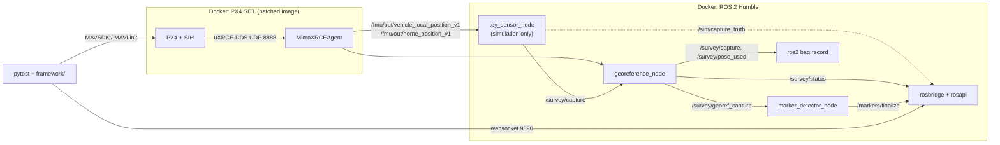

# Line survey: a toy sensor on a ROS 2 pipeline, tested end to end

The flight tests in M1 to M5 check what the drone does. This extension checks what a
drone does *with a payload*: it flies a straight survey line 0.4 m above the ground, a
sensor takes timestamped captures, a georeferencing node puts each capture on the line
using the vehicle's pose, and a detector finds painted ground markers. The test fails
if the markers are not found where they are, if the line is not covered, if the clock
of the sensor shifts the result by more than it should, or if replaying the recording
gives other results than the flight did.

The sensor is a toy, on purpose: the point is the test design, not the payload. The same
pipeline (pose adapter, interpolation at the capture time, line projection, a usable or
unusable decision with a reason, coverage) is what any survey payload needs.

## What runs where



| Part | Where | Role |
|---|---|---|
| Test harness | `framework/`, `tests/` | Starts PX4 and the ROS container, flies the mission over MAVSDK, talks to ROS over rosbridge only |
| `sensor_bridge` | `ros2_ws/src/sensor_bridge` | The code under test: pose adapter, line projection, interpolation, hold queue, decisions, coverage. The pure modules import neither ROS nor `px4_msgs`, so their unit tests run on the CI runner |
| `sensor_bridge_msgs` | `ros2_ws/src/sensor_bridge_msgs` | Messages and services between the nodes (`SensorCapture`, `GeorefCapture`, `SurveyStatus`, `Marker`, `PoseSample`, `Stop`, `Flush`, `Finalize`) |
| `survey_demo` | `ros2_ws/src/survey_demo` | The toy sensor, the marker detector, the ready gate, the replay bag player, the launch files |
| `survey_demo_msgs` | `ros2_ws/src/survey_demo_msgs` | `CaptureTruth`: where the sensor really was. Simulation only; the nodes under test must not subscribe to `/sim/*` (the test checks this through `rosapi`, before and after the flight) |

## The toy sensor

Looking straight down, it reads the sum of Gaussian footprints of the painted markers
around it (peak 0.8, footprint sigma 0.2 m, reading noise 0.02, clipped at 1.0), 20
captures per second of simulated time, four samples per capture 10 ms apart, each with
its own timestamp. The stamp is the true time plus a configurable clock offset and
jitter. The sensor sits 15 cm ahead of the vehicle origin (a lever arm), so a
georeferencing that ignores the offset puts every marker 15 cm off.

The sensor reads the position that PX4 *estimates*, like the georeferencing node does.
The pipeline test therefore checks the chain from pose to marker position (timing,
interpolation, lever arm, projection, decisions). How well PX4 estimates the position is
a separate question that the test answers with the simulator's ground truth: see
[the true-versus-estimated check](qa-notes.md#low-altitude-line-following).

## A scenario

```yaml
name: line_survey_markers
type: line_survey
profile: low_altitude               # PX4 parameter overlay, scenarios/_low_altitude.yaml
line: {start_north_m: 5.0, start_east_m: 0.0, heading_deg: 0.0, length_m: 12.0}
sensor_height_m: 0.4
sensor_offset_m: {x: 0.15, y: 0.0, z: 0.0}
speed_m_s: 1.0
markers:
  - {s_m: 2.5, d_m: 0.0, amplitude: 0.8}
  - {s_m: 6.0, d_m: 0.15, amplitude: 0.7}
  - {s_m: 9.5, d_m: 0.0, amplitude: 0.8}
clock: {offset_ms: 0.0, jitter_ms: 0.0}
seed: 0
replay_check: true
px4_params: {UXRCE_DDS_SYNCT: 0}
```

| Scenario | Schedule | What it adds |
|---|---|---|
| `line_survey_markers` | every run | The main case, with the replay check |
| `line_survey_clock_plus` | every run | Sensor clock 20 ms ahead of PX4 time (jitter 1 ms) |
| `line_survey_clock_minus` | weekly | Sensor clock 20 ms behind |
| `line_survey_no_markers` | weekly | A clean line: the detector must report nothing |

## The test (`tests/test_line_survey.py`)

1. Start PX4 (patched image, DDS domain and own-IP options) and the ROS container; wait
   for `SURVEY READY`, connect to rosbridge, subscribe, check with `rosapi` that the
   nodes under test subscribe to no `/sim/*` topic, wait for the first pose.
2. Take off to the sensor height, fly the mission: run-in, line start, line end,
   run-out. While it flies, read the **sensor lag** (below).
3. Land, call `/survey/stop`, wait until the last capture is georeferenced and the queue
   is empty, call `/markers/finalize`, check `rosapi` again.
4. Compute the figures from the two recordings (the sensor's true positions and the
   georeferenced captures), from MAVSDK telemetry and from the PX4 log (when the range
   finder joined the height estimate).
5. Check every rule below and report all failures in one assertion.
6. If `replay_check`: stop the live container, replay the bag into fresh nodes, compare.

| Rule | Checked by |
|---|---|
| Coverage of the line by usable captures is at least 0.95 (gaps up to 1.5 capture spacings are allowed), measured from the sensor's own positions; the georeferencing node's coverage agrees within 0.01; no usable capture was built without a pose | `framework.survey.truth_figures` |
| Flight: height within 0.4 +- 0.15 m, cross-track within 0.3 m, line speed within 10 % of 1 m/s, over the line only | MAVSDK telemetry, `framework/assertions.py` |
| Range finder: fused into the height estimate within 3 s of take-off (the log shows 0.70 to 0.78 s with the detector patch, up to 12 s without it) | The PX4 log (ULog) after the flight, `framework/ulog_checks.py`; a missing or unreadable log fails |
| Every painted marker found within 0.10 m of its position; no marker anywhere else | `framework.survey.evaluate_markers` |
| Clock offset: mean georeferenced minus true position equals speed x offset within 1 cm | `truth_figures` |
| Replay: the same usable/unusable decision and reason for every capture from takeoff on; the same markers within 1 cm | `framework/replay_check.py` |
| Sensor lag: the sensor trails the newest PX4 pose by at most 5 simulated seconds during the mission | `framework.survey.sensor_lag_s` |

Why "from takeoff on" in the replay check: the sensor starts capturing on the ground,
and the poses before takeoff are only the pre-roll of the first in-flight captures. The
ground captures are not part of the comparison (their count is recorded).

Most of the logic is pure and unit tested without a simulator, including a complete
in-process run of the chain (`tests/unit/test_markers.py`): poses, sensor,
georeferencing, detector. It pins what the flight test may expect, for example that a
+20 ms clock moves every marker by +2 cm and that a georeferencing without the lever
arm moves every marker by -15 cm.

## Running it

```sh
pip install -e ".[dev,ros]"
python -m framework.config image        # then build or pull the PX4 image, see the README
scripts/build_px4_image.sh              # PX4 with the lockstep fix (compiles PX4, slow the first time)
scripts/build_ros2_images.sh base       # ROS 2 Humble, DDS agent, px4_msgs (slow; cached in CI)
scripts/build_ros2_images.sh thin       # the survey packages on top 
pytest tests/test_line_survey.py -k line_survey_markers
```

Artifacts of a run: `artifacts/ros/<test>/live/` (bag, `decisions.jsonl`, `markers.json`,
ROS logs), `artifacts/ros/<test>/recordings/` (every topic the test subscribed to, as
JSON lines), the PX4 ULog under `artifacts/ulog/`, and the container logs.
